# 📚 LAPORAN LENGKAP PENGEMBANGAN SISTEM & DOKUMEN ARSITEKTUR SKRIPSI
## Sistem Informasi Manajemen Perpustakaan SMA Muhammadiyah 1 Pekalongan Berbasis Web

> **Dokumen Resmi Rujukan Tugas Akhir / Skripsi & Mata Kuliah Basis Data Lanjut (Semester 5)**  
> **Program Studi:** S1 Ilmu Komputer / Sistem Informasi — Universitas Muhammadiyah Metro  
> **Instansi Penelitian:** SMA Muhammadiyah 1 Pekalongan, Kabupaten Lampung Timur  
> **Repositori Resmi GitHub:** [https://github.com/fanydarat757-hash/antigrafitytest](https://github.com/fanydarat757-hash/antigrafitytest)  
> **Status Sistem:** Selesai, Teruji 100% (*Production Ready*, Lulus Black Box Testing & Terverifikasi MySQL/Vite)

---

## 📑 DAFTAR ISI LAPORAN

1. [Identitas Sistem, Objek Penelitian & Ringkasan Eksekutif](#1-identitas-sistem-objek-penelitian--ringkasan-eksekutif)
2. [Matriks Hak Akses Pengguna & Entitas Sistem (RBAC Komprehensif)](#2-matriks-hak-akses-pengguna--entitas-sistem-rbac-komprehensif)
   - [2.1 Definisi 4 Aktor Pengguna Sistem](#21-definisi-4-aktor-pengguna-sistem)
   - [2.2 Definisi 6 Entitas Basis Data](#22-definisi-6-entitas-basis-data)
   - [2.3 Matriks Hak Akses CRUD Entitas](#23-matriks-hak-akses-crud-entitas-entity-role-matrix)
   - [2.4 Matriks 20 Fitur Operasional Lanjutan](#24-matriks-20-fitur-operasional-lanjutan-extended-permissions)
   - [2.5 Diagram Aliran Data Wewenang Otorisasi](#25-diagram-aliran-data-wewenang-otorisasi)
3. [Arsitektur Sistem 3-Tier (Modern Decoupled Client-Server)](#3-arsitektur-sistem-3-tier-modern-decoupled-client-server)
4. [Diagram Konteks & Data Flow Diagram (DFD Level 0 & Level 1)](#4-diagram-konteks--data-flow-diagram-dfd-level-0--level-1)
5. [Use Case Diagram UML & Spesifikasi Peranan](#5-use-case-diagram-uml--spesifikasi-peranan)
6. [Struktur Basis Data 3NF, ERD & Populasi 20+ Data Dummy](#6-struktur-basis-data-3nf-erd--populasi-20-data-dummy)
   - [6.1 Entity Relationship Diagram (ERD Terkoneksi Penuh)](#61-entity-relationship-diagram-erd-terkoneksi-penuh)
   - [6.2 Kaidah Normalisasi Bentuk Ketiga (3NF)](#62-kaidah-normalisasi-bentuk-ketiga-3nf)
   - [6.3 Ringkasan Volume Dataset (Target vs Realisasi Aktual)](#63-ringkasan-volume-dataset-target-vs-realisasi-aktual)
   - [6.4 Daftar 25 Master Koleksi Buku (`tb_buku`)](#64-daftar-25-master-koleksi-buku-tb_buku)
   - [6.5 Daftar 25 Master Siswa / Anggota (`tb_anggota`)](#65-daftar-25-master-siswa--anggota-tb_anggota)
   - [6.6 Rincian Transaksi Sirkulasi Peminjaman & Pengembalian](#66-rincian-transaksi-sirkulasi-peminjaman--pengembalian)
   - [6.7 Master Petugas & Konfigurasi SOP (`tb_pengaturan`)](#67-master-petugas--konfigurasi-sop-tb_pengaturan)
7. [Activity Diagram, State Machine & Sequence Diagram](#7-activity-diagram-state-machine--sequence-diagram)
   - [7.1 Activity Diagram Peminjaman Buku](#71-activity-diagram-peminjaman-buku)
   - [7.2 Activity Diagram Pengembalian & Denda](#72-activity-diagram-pengembalian--denda)
   - [7.3 Sequence Diagram Interaksi Payment Gateway QRIS](#73-sequence-diagram-interaksi-payment-gateway-qris)
   - [7.4 State Machine Diagram Siklus Status Pustaka](#74-state-machine-diagram-siklus-status-pustaka)
8. [Class Diagram & Pemodelan Berorientasi Objek](#8-class-diagram--pemodelan-berorientasi-objek)
9. [Standar Operasional Prosedur & Flowchart Sistem (7 Alur)](#9-standar-operasional-prosedur--flowchart-sistem-7-alur)
10. [Panduan Instalasi, Menjalankan Aplikasi & Kredensial Demo](#10-panduan-instalasi-menjalankan-aplikasi--kredensial-demo)
11. [Hasil Verifikasi Teknis & Pengujian Black Box Testing (17 Kasus)](#11-hasil-verifikasi-teknis--pengujian-black-box-testing-17-kasus)
    - [11.1 Verifikasi Integritas MySQL Basis Data](#111-verifikasi-integritas-mysql-basis-data)
    - [11.2 Verifikasi Kompilasi Frontend React (Vite Build)](#112-verifikasi-kompilasi-frontend-react-vite-build)
    - [11.3 Pengujian Fungsional Black Box Testing (17 Skenario)](#113-pengujian-fungsional-black-box-testing-17-skenario)
12. [Profil Penyusun](#12-profil-penyusun)

---

## 📌 1. Identitas Sistem, Objek Penelitian & Ringkasan Eksekutif

* **Nama Sistem**: Sistem Informasi Manajemen Perpustakaan Berbasis Web Modern
* **Instansi Mitra**: SMA Muhammadiyah 1 Pekalongan, Kabupaten Lampung Timur, Lampung
* **Alamat Sekolah**: Jl. Raya Pekalongan, Kec. Pekalongan, Kab. Lampung Timur, Prov. Lampung
* **Teknologi Utama**:
  * **Frontend**: React.js 18 (Vite SPA) + Tailwind CSS + Lucide React Icons (Port 3000)
  * **Backend**: Arsitektur RESTful API PHP 8.2+ / Service Layer Pattern (Port 8000)
  * **Basis Data**: MySQL 8.x / MariaDB (Storage Engine InnoDB dengan Relasi Foreign Key Strict)
  * **Gerbang Pembayaran**: QRIS Nasional (NMID: ID1026632009753, Merchant: lupayyy, Konter) & Multi-Bank Virtual Account (BCA, Mandiri, BRI)
* **Ringkasan Transformasi**:
  Sistem ini mentransformasikan operasional perpustakaan sekolah konvensional (pencatatan buku besar kertas & sistem lokal legacy) menjadi sistem digital terpadu yang transparan, presisi, dan terotomatisasi. Sistem mengintegrasikan validasi kuota pinjam 2 buku per siswa, kalkulasi denda harian dinamis, notifikasi WhatsApp Gateway, portal mandiri pencetakan KTA digital ber-barcode NISN, serta modul pengesahan dokumen bertanda tangan digital oleh Kepala Sekolah.

---

## 🔐 2. Matriks Hak Akses Pengguna & Entitas Sistem (RBAC Komprehensif)

Sistem mengimplementasikan kendali akses berbasis peran (*Role-Based Access Control / RBAC*) yang ketat dengan pemisahan wewenang (*Separation of Duties*) antara 4 aktor pengguna terhadap 6 entitas basis data utama:

### 2.1 Definisi 4 Aktor Pengguna Sistem
1. **Kepala Unit Perpustakaan (`admin` / Siti Farida, A.Md)**:
   - **Peranan:** Administrator Utama & Manajerial Perpustakaan.
   - **Wewenang:** Pengelolaan master katalog buku, penataan barcode rak fisik, manajemen data siswa dan staf, penetapan kebijakan operasional perpustakaan (tarif denda per hari, masa pinjam, biaya administrasi) pada tabel `tb_pengaturan`, monitoring rekapitulasi denda, serta pencetakan laporan inventaris.
2. **Petugas Layanan & Sirkulasi (`petugas2` / Samsul Arifin, S.Pd)**:
   - **Peranan:** Operator Loket Front-Desk Sirkulasi.
   - **Wewenang:** Pelayanan transaksi peminjaman buku harian siswa, validasi kuota pinjam maksimal 2 buku aktif, pengecekan fisik buku saat pengembalian, kalkulasi denda otomatis, penyesuaian/dispensasi denda saat pengembalian, penerimaan kas tunai di loket maupun verifikasi QRIS, pencetakan kwitansi sah, dan pengiriman notifikasi pengingat via WhatsApp Gateway kepada siswa yang menunggak.
3. **Kepala Sekolah / Supervisor Eksekutif (`kepsek` / Ahmad Marzuki, S.Pd.I)**:
   - **Peranan:** Supervisor Eksekutif & Penjamin Mutu (*Executive Supervisor*).
   - **Wewenang:** Mengawasi indikator kinerja utama (KPI) literasi dan minat baca siswa, mengaudit inventaris koleksi buku sekolah secara *read-only*, serta melakukan **Pengesahan Resmi Laporan Perpustakaan** dengan membubuhkan tanda tangan digital dan stempel sekolah pada dokumen laporan untuk keperluan akreditasi sekolah.
4. **Siswa / Anggota Perpustakaan (`siswa` / Login: NISN)**:
   - **Peranan:** Pengguna Layanan Mandiri (*Self-Service Portal*).
   - **Wewenang:** Mencari katalog buku dan letak rak fisiknya, mendaftar akun anggota secara mandiri, mengunduh Kartu Tanda Anggota (KTA) digital ber-barcode NISN, memantau riwayat peminjaman buku, memperpanjang masa pinjam secara mandiri, dan melunasi denda keterlambatan melalui scan QRIS Nasional.

---

### 2.2 Definisi 6 Entitas Basis Data
1. **`tb_buku`**: Master katalog koleksi pustaka fisik perpustakaan.
2. **`tb_anggota`**: Master data siswa dan anggota perpustakaan.
3. **`tb_petugas`**: Master kredensial akun staf dan tingkatan hak akses.
4. **`tb_peminjaman`**: Transaksi peminjaman buku dan perpanjangan durasi pinjam.
5. **`tb_pengembalian`**: Transaksi pengembalian fisik buku dan denda keterlambatan.
6. **`tb_pengaturan`**: Konfigurasi SOP sistem (tarif denda, durasi pinjam, biaya administrasi).

---

### 2.3 Matriks Hak Akses CRUD Entitas (Entity-Role Matrix)

| Entitas Basis Data / Modul | Kepala Perpustakaan (`admin`) | Petugas Sirkulasi (`petugas2`) | Kepala Sekolah (`kepsek`) | Siswa / Anggota (`siswa`) |
| :--- | :---: | :---: | :---: | :---: |
| **`tb_buku` (Master Koleksi Buku)** | **C, R, U, D** | **R** | **R** | **R** |
| **`tb_anggota` (Data Siswa/Anggota)** | **C, R, U, D** | **R, U** | **R** | **C, R, U\*** |
| **`tb_petugas` (Akun Staf & RBAC)** | **C, R, U, D** | **R, U\*** | **R** | **-** |
| **`tb_peminjaman` (Transaksi Pinjam)** | **C, R, U, D** | **C, R, U** | **R** | **C\*, R\*** |
| **`tb_pengembalian` (Pengembalian)** | **C, R, U, D** | **C, R, U** | **R** | **R\*** |
| **`tb_pengaturan` (Konfigurasi SOP)** | **C, R, U, D** | **R, U** | **R** | **R** |
| **Modul Denda & Kwitansi** | **C, R, U, D** | **C, R, U** | **R** | **R\*, Pay** |
| **Laporan & Dokumen Resmi** | **R, Export, Print** | **R, Export, Print** | **R, Export, Sign** | **R\*** |

*\*Keterangan Aturan Bisnis & Least-Privilege:*
- `C, R, U*` (Siswa pada `tb_anggota`): Siswa hanya dapat mendaftar baru (C) dan mengedit data profil pribadinya (R, U).
- `R, U*` (Petugas pada `tb_petugas`): Petugas hanya berwenang memperbarui nama profil dan foto miliknya sendiri.
- `C*, R*` (Siswa pada `tb_peminjaman` & `tb_pengembalian`): Siswa hanya dapat mengajukan perpanjangan/peminjaman mandiri dan melihat riwayat transaksinya sendiri.
- `R*, Pay` (Siswa pada Modul Denda): Siswa hanya dapat melihat rincian denda miliknya, membayar via QRIS, dan mencetak struk bukti pembayaran mandiri.

---

### 2.4 Matriks 20 Fitur Operasional Lanjutan (Extended Permissions)

| No | Fitur Operasional Spesifik | Kepala Perpus | Petugas Sirkulasi | Kepala Sekolah | Siswa / Anggota |
| :-: | :--- | :---: | :---: | :---: | :---: |
| 1 | Tambah / Edit / Hapus Master Koleksi Buku | ✅ Ya | ❌ Tidak | ❌ Tidak | ❌ Tidak |
| 2 | Generate Barcode Rak Buku (Standar Code 128) | ✅ Ya | ✅ Ya | ❌ Tidak | ❌ Tidak |
| 3 | Ekspor Data Buku ke Format Excel / CSV | ✅ Ya | ✅ Ya | ✅ Ya | ❌ Tidak |
| 4 | Input Peminjaman Koleksi Buku Baru | ✅ Ya | ✅ Ya | ❌ Tidak | ✅ Ya (Mandiri) |
| 5 | Dispensasi Pelanggaran Kuota (> 2 Buku) | ✅ Ya | ✅ Ya | ❌ Tidak | ❌ Tidak |
| 6 | Perpanjang Masa Pinjam (+7 Hari) | ✅ Ya | ✅ Ya | ❌ Tidak | ✅ Ya (Maks 1x) |
| 7 | Override Tanggal Jatuh Tempo Kustom | ✅ Ya | ✅ Ya | ❌ Tidak | ❌ Tidak |
| 8 | Edit / Bebaskan Denda (Dispensasi Rp 0) | ✅ Ya | ✅ Ya | ❌ Tidak | ❌ Tidak |
| 9 | Edit Besaran Denda pada Riwayat Pengembalian | ✅ Ya | ✅ Ya | ❌ Tidak | ❌ Tidak |
| 10 | Cetak Struk Kwitansi Denda Resmi Loket | ✅ Ya | ✅ Ya | ❌ Tidak | ✅ Ya (Struk Sendiri) |
| 11 | Penerimaan Pembayaran Tunai Loket Perpustakaan | ✅ Ya | ✅ Ya | ❌ Tidak | ❌ Tidak |
| 12 | Pembayaran Denda via Gateway QRIS Multi-Bank | ✅ Ya | ✅ Ya | ❌ Tidak | ✅ Ya (Scan QRIS) |
| 13 | Notifikasi WhatsApp Gateway (1-Klik Tagihan) | ❌ Tidak | ✅ Ya (1-Klik WA) | ❌ Tidak | ❌ Tidak |
| 14 | Cetak Kartu Tanda Anggota (KTA) Barcode NISN | ✅ Ya | ✅ Ya | ❌ Tidak | ✅ Ya (KTA Sendiri) |
| 15 | Konfigurasi Tarif Denda Global (`tb_pengaturan`) | ✅ Ya | ✅ Ya | ❌ Tidak | ❌ Tidak |
| 16 | Filter Riwayat Transaksi Berdasarkan Rentang Tanggal | ✅ Ya | ✅ Ya | ✅ Ya | ❌ Tidak |
| 17 | Unduh Rekapitulasi Laporan ke Spreadsheet CSV | ✅ Ya | ✅ Ya | ✅ Ya | ❌ Tidak |
| 18 | Cetak Dokumen Laporan Resmi Ber-KOP Sekolah | ✅ Ya | ✅ Ya | ✅ Ya | ❌ Tidak |
| 19 | Pengesahan & Tanda Tangan Digital Resmi Dokumen | ❌ Tidak | ❌ Tidak | ✅ Ya (Otoritas Utama) | ❌ Tidak |
| 20 | Manajemen & Penonaktifan Akun Staf Petugas | ✅ Ya | ❌ Tidak | ❌ Tidak | ❌ Tidak |

---

### 2.5 Diagram Aliran Data Wewenang Otorisasi

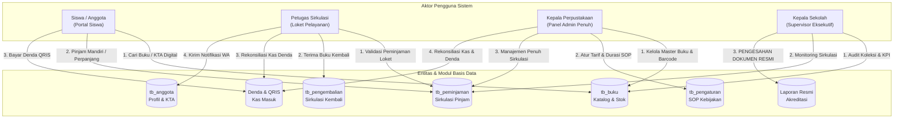

---

## 🏗️ 3. Arsitektur Sistem 3-Tier (Modern Decoupled Client-Server)

Sistem menggunakan model arsitektur **Modern Decoupled Client-Server (3-Tier)** yang memisahkan antarmuka interaktif pengguna, logika bisnis terpusat, dan persistensi basis data relasional serta layanan payment gateway eksternal.

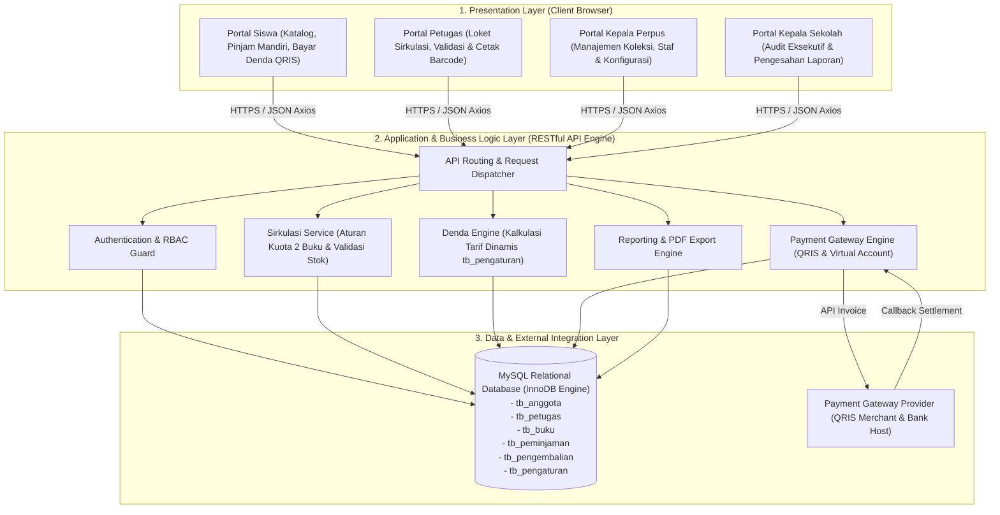

---

## 🔄 4. Diagram Konteks & Data Flow Diagram (DFD Level 0 & Level 1)

### Diagram Konteks (Context Diagram / DFD Level 0)
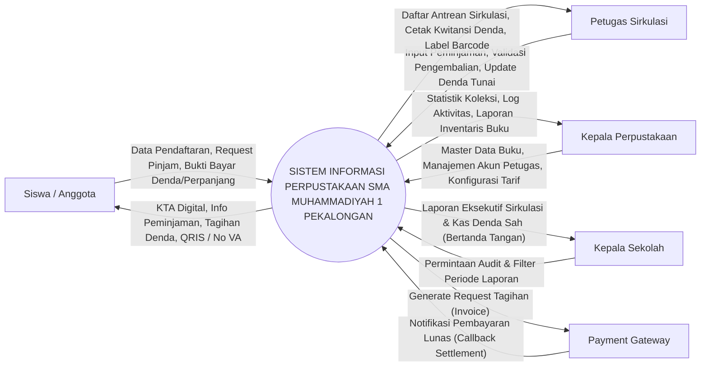

### Data Flow Diagram (DFD Level 1)
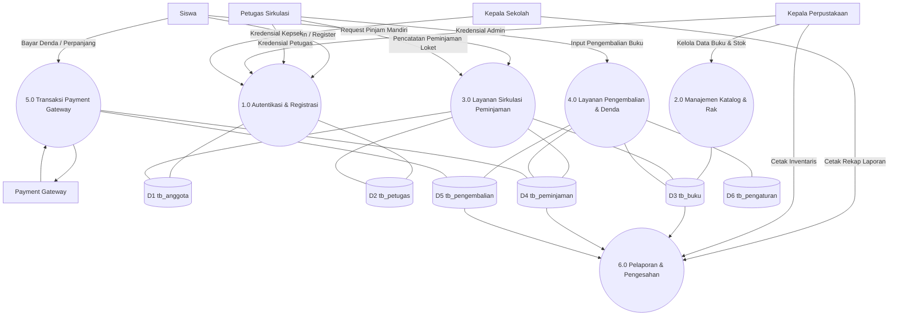

---

## 🎭 5. Use Case Diagram UML & Spesifikasi Peranan

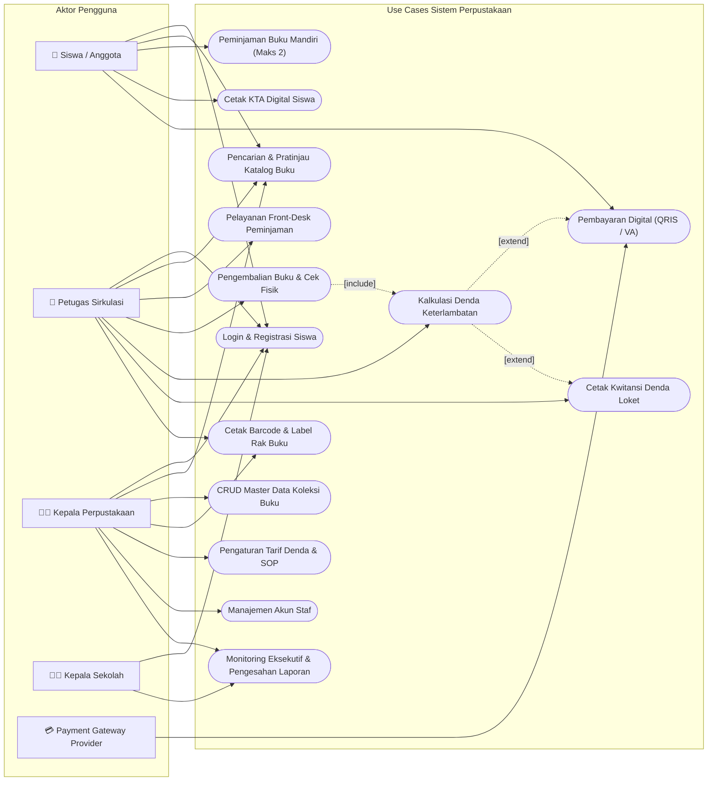

---

## 🗄️ 6. Struktur Basis Data 3NF, ERD & Populasi 20+ Data Dummy

### 6.1 Entity Relationship Diagram (ERD Terkoneksi Penuh)

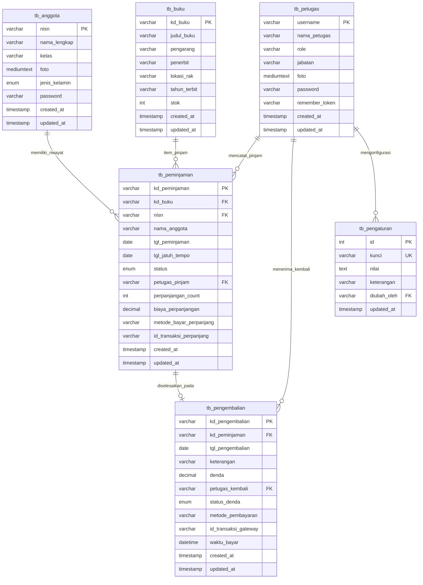

---

### 6.2 Kaidah Normalisasi Bentuk Ketiga (3NF)

1. **Bentuk Normal Pertama (1NF)**: Setiap kolom hanya memuat nilai skalar tunggal (atomik), tidak ada kolom bernilai jamak (*multivalued*), dan tidak ada kelompok berulang (*repeating groups*).
2. **Bentuk Normal Kedua (2NF)**: Memenuhi 1NF dan seluruh atribut bukan kunci (*non-key attributes*) memiliki ketergantungan fungsional penuh (*fully functionally dependent*) pada kunci utama (*Primary Key*).
3. **Bentuk Normal Ketiga (3NF)**: Memenuhi 2NF dan tidak mengandung ketergantungan transitif (*no transitive dependency*), di mana atribut bukan kunci tidak boleh bergantung pada atribut bukan kunci lainnya.

---

### 6.3 Ringkasan Volume Dataset (Target vs Realisasi Aktual)

| Nama Tabel / Entitas | Target Minimal Tugas | Realisasi Aktual | Persentase | Status Pengujian |
| :--- | :---: | :---: | :---: | :---: |
| **`tb_buku`** (Master Koleksi Buku) | $\ge 20$ record | **25 Buku** | **125%** | ✅ Valid (MySQL & Mock Sync) |
| **`tb_anggota`** (Master Siswa/Anggota) | $\ge 20$ record | **25 Siswa** | **125%** | ✅ Valid (MySQL & Mock Sync) |
| **`tb_peminjaman`** (Sirkulasi Pinjam) | $\ge 20$ record | **25 Transaksi** | **125%** | ✅ Valid (MySQL & Mock Sync) |
| **`tb_pengembalian`** (Sirkulasi Kembali) | $\ge 20$ record | **20 Transaksi** | **100%** | ✅ Valid (MySQL & Mock Sync) |
| **`tb_petugas`** (Staf & Supervisor) | $\ge 3$ record | **3 Akun** | **100%** | ✅ Valid (MySQL & Mock Sync) |
| **`tb_pengaturan`** (Kebijakan SOP) | 1 konfigurasi | **1 Master SOP** | **100%** | ✅ Valid (MySQL & Mock Sync) |

---

### 6.4 Daftar 25 Master Koleksi Buku (`tb_buku`)

| Kode Buku | Judul Buku | Pengarang | Penerbit | Tahun | Stok | Rak Fisik |
| :--- | :--- | :--- | :--- | :-: | :-: | :--- |
| `BK001` | Matematika Diskrit Berbasis Studi Kasus | Rinaldi Munir | Informatika | 2021 | 5 | Rak MIPA-01 |
| `BK002` | Pemrograman Web dengan React & PHP | Budi Raharjo | Informatika | 2023 | 3 | Rak TI-02 |
| `BK003` | Basis Data Lanjut Teori & Implementasi SQL | Abdul Kadir | Andi Publisher | 2022 | 4 | Rak TI-01 |
| `BK004` | Algoritma dan Pemrograman Modern | Dr. Eng. R. H. Sianipar | Informatika | 2020 | 6 | Rak TI-03 |
| `BK005` | Fisika Dasar untuk Sains dan Teknik | Halliday & Resnick | Erlangga | 2019 | 4 | Rak MIPA-02 |
| `BK006` | Kimia Terapan Kurikulum Merdeka | Michael Purba | Erlangga | 2022 | 5 | Rak MIPA-03 |
| `BK007` | Biologi Molekuler dan Genetika SMA | Campbell & Reece | Erlangga | 2021 | 3 | Rak MIPA-04 |
| `BK008` | Sejarah Peradaban Islam & Kemuhammadiyahan | Tim Majelis Dikdasmen | Suara Muhammadiyah | 2020 | 7 | Rak Agama-01 |
| `BK009` | Fiqih Ibadah & Muamalah Kontemporer | Prof. Wahbah Zuhaili | Gema Insani | 2019 | 4 | Rak Agama-02 |
| `BK010` | Akidah Akhlak Madrasah Aliyah & SMA | Prof. Dr. Yunahar Ilyas | Suara Muhammadiyah | 2022 | 6 | Rak Agama-03 |
| `BK011` | Bahasa Indonesia Akademik & Tata Tulis | E. Zainal Arifin | Pustaka Mandiri | 2021 | 5 | Rak Bahasa-01 |
| `BK012` | English for Academic Purposes & TOEFL Prep | Raymond Murphy | Cambridge | 2020 | 4 | Rak Bahasa-02 |
| `BK013` | Sosiologi: Menyelami Fenomena Sosial | Soerjono Soekanto | Rajawali Pers | 2019 | 3 | Rak Sosial-01 |
| `BK014` | Ekonomi Moneter & Perbankan Indonesia | Boediono | BPFE Yogyakarta | 2021 | 5 | Rak Sosial-02 |
| `BK015` | Geografi Regional dan Mitigasi Bencana | Bambang Utoyo | Yudhistira | 2020 | 4 | Rak Sosial-03 |
| `BK016` | Pendidikan Pancasila & Kewarganegaraan | Kaelan | Paradigma | 2022 | 6 | Rak Sosial-04 |
| `BK017` | Antropologi Budaya Nusantara | Koentjaraningrat | Gramedia | 2018 | 3 | Rak Sosial-05 |
| `BK018` | Statistika Praktis untuk Analisis Data | Sudjana | Tarsito | 2021 | 5 | Rak MIPA-05 |
| `BK019` | Jaringan Komputer & Keamanan Siber | Onno W. Purbo | Andi Publisher | 2023 | 4 | Rak TI-04 |
| `BK020` | Rekayasa Perangkat Lunak Terstruktur | Roger S. Pressman | McGraw-Hill | 2020 | 3 | Rak TI-05 |
| `BK021` | Sejarah Kebudayaan Indonesia Abad 20 | Sartono Kartodirdjo | Gramedia | 2019 | 4 | Rak Sosial-06 |
| `BK022` | Seni Rupa & Desain Komunikasi Visual | Dharsono Sony Kartika | Rekayasa Sains | 2021 | 5 | Rak Budaya-01 |
| `BK023` | Bimbingan Konseling & Psikologi Remaja | Prof. Syamsu Yusuf | Rosdakarya | 2020 | 4 | Rak Konseling-01 |
| `BK024` | Kewirausahaan Kreatif Generasi Muda | Hendro | Erlangga | 2022 | 6 | Rak Bisnis-01 |
| `BK025` | Ensiklopedia Sains & Teknologi Dunia | Tim Redaksi Pustaka | Lentera Hati | 2023 | 2 | Rak Referensi-01 |

---

### 6.5 Daftar 25 Master Siswa / Anggota (`tb_anggota`)

| No | NISN (Login) | Nama Lengkap Siswa | Kelas | No. Handphone / WhatsApp | Alamat Siswa |
| :-: | :--- | :--- | :---: | :--- | :--- |
| 1 | `2024001` | Muhammad Rizky Pratama | XII MIPA 1 | 081234567890 | Jl. Ahmad Dahlan No. 12, Pekalongan |
| 2 | `2024002` | Annisa Putri Maharani | XI IPS 2 | 081234567891 | Jl. Sudirman No. 45, Batanghari |
| 3 | `2024003` | Dimas Arya Sena | XII MIPA 2 | 081234567892 | Jl. Ki Hajar Dewantara No. 8, Metro |
| 4 | `2024004` | Siti Nur Aini | X-1 | 081234567893 | Jl. KH Ahmad Dahlan No. 99, Pekalongan |
| 5 | `2024005` | Fajar Ramadhan | XI MIPA 1 | 081234567894 | Jl. Merdeka No. 17, Sekampung |
| 6 | `2024006` | Dewi Lestari | XII IPS 1 | 081234567895 | Jl. Diponegoro No. 3, Batanghari |
| 7 | `2024007` | Rahmat Hidayat | XI MIPA 2 | 081234567896 | Jl. Gajah Mada No. 22, Pekalongan |
| 8 | `2024008` | Tiara Safitri | X-2 | 081234567897 | Jl. Imam Bonjol No. 14, Pekalongan |
| 9 | `2024009` | Bagas Kurniawan | XII MIPA 1 | 081234567898 | Jl. Pahlawan No. 56, Pekalongan |
| 10 | `2024010` | Nurul Hasanah | XI IPS 1 | 081234567899 | Jl. Kartini No. 7, Pekalongan |
| 11 | `2024011` | Bayu Pamungkas | X-3 | 081345678901 | Jl. Hasanuddin No. 88, Pekalongan |
| 12 | `2024012` | Indah Permatasari | XII IPS 2 | 081345678902 | Jl. Cut Nyak Dien No. 19, Pekalongan |
| 13 | `2024013` | Galih Pratama | XI MIPA 3 | 081345678903 | Jl. Teuku Umar No. 31, Pekalongan |
| 14 | `2024014` | Zahra Amelia | X-1 | 081345678904 | Jl. Pattimura No. 62, Batanghari |
| 15 | `2024015` | Dede Kurnia | XII MIPA 2 | 081345678905 | Jl. Raden Intan No. 5, Metro |
| 16 | `2024016` | Maya Anggraini | XI IPS 2 | 081345678906 | Jl. Dr. Sutomo No. 11, Pekalongan |
| 17 | `2024017` | Hendra Wijaya | X-2 | 081345678907 | Jl. Yos Sudarso No. 44, Pekalongan |
| 18 | `2024018` | Putri Sekar Arum | XII MIPA 1 | 081345678908 | Jl. Veteran No. 23, Pekalongan |
| 19 | `2024019` | Aditya Pratama | XI MIPA 1 | 081345678909 | Jl. Pemuda No. 78, Pekalongan |
| 20 | `2024020` | Luthfi Hakim | X-3 | 081345678910 | Jl. Cendrawasih No. 15, Pekalongan |
| 21 | `2024021` | Nabila Syakieb | XII IPS 1 | 081345678911 | Jl. Melati No. 2, Batanghari |
| 22 | `2024022` | Kevin Sanjaya | XI IPS 1 | 081345678912 | Jl. Anggrek No. 9, Pekalongan |
| 23 | `2024023` | Farhan Maulana | X-2 | 081345678913 | Jl. Mawar No. 33, Pekalongan |
| 24 | `2024024` | Tari Rahmawati | XII MIPA 2 | 081345678914 | Jl. Flamboyan No. 27, Pekalongan |
| 25 | `2024025` | Wildan Nugraha | XI MIPA 2 | 081345678915 | Jl. Kenanga No. 51, Pekalongan |

---

### 6.6 Rincian Transaksi Sirkulasi Peminjaman & Pengembalian
- **Peminjaman (`tb_peminjaman`)**:
  - `PJ001` s/d `PJ020`: Transaksi selesai yang telah dikembalikan (`status = kembali`).
  - `PJ021` s/d `PJ025`: Transaksi aktif yang sedang berjalan (`status = dipinjam`), termasuk buku yang mendekati jatuh tempo dan melewati jatuh tempo guna menguji kalkulasi denda dinamis dan fitur WhatsApp Reminder.
- **Pengembalian & Denda (`tb_pengembalian`)**:
  - `KB001` s/d `KB020`: Total 20 data pengembalian dengan rincian denda bervariasi:
    - 11 Transaksi bebas denda / tepat waktu ($denda = 0$, `status_denda = lunas`).
    - 5 Transaksi terlambat dilunasi melalui **Payment Gateway QRIS Nasional** (`metode_pembayaran = QRIS`, disertai ID Transaksi settlement resmi).
    - 4 Transaksi terlambat dilunasi secara **Tunai di Loket Konter Sirkulasi** (`metode_pembayaran = Tunai Loket`).

---

### 6.7 Master Petugas & Konfigurasi SOP (`tb_pengaturan`)

- **Master Petugas (`tb_petugas`)**:
  - `admin` (Siti Farida, A.Md - Kepala Unit Perpustakaan)
  - `petugas2` (Samsul Arifin, S.Pd - Petugas Sirkulasi)
  - `kepsek` (Ahmad Marzuki, S.Pd.I - Kepala Sekolah)
- **Konfigurasi SOP (`tb_pengaturan`)**:
  - `tarif_denda`: Rp 1.000 / hari keterlambatan
  - `durasi_pinjam`: 7 hari kalender
  - `biaya_perpanjangan`: Rp 0 (Dispensasi)
  - `qris_merchant`: `lupayyy, Konter`
  - `qris_nmid`: `ID1026632009753`

---

## 📈 7. Activity Diagram, State Machine & Sequence Diagram

### 7.1 Activity Diagram Peminjaman Buku
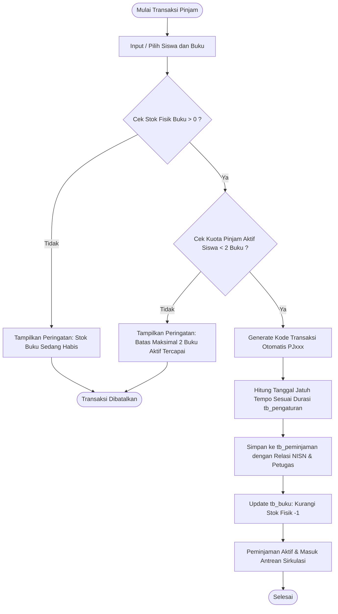

### 7.2 Activity Diagram Pengembalian & Denda
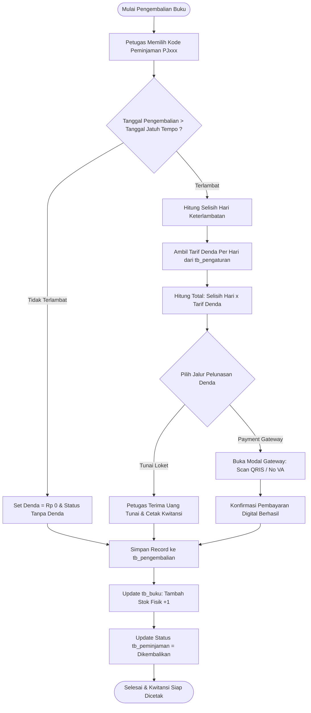

### 7.3 Sequence Diagram Interaksi Payment Gateway QRIS
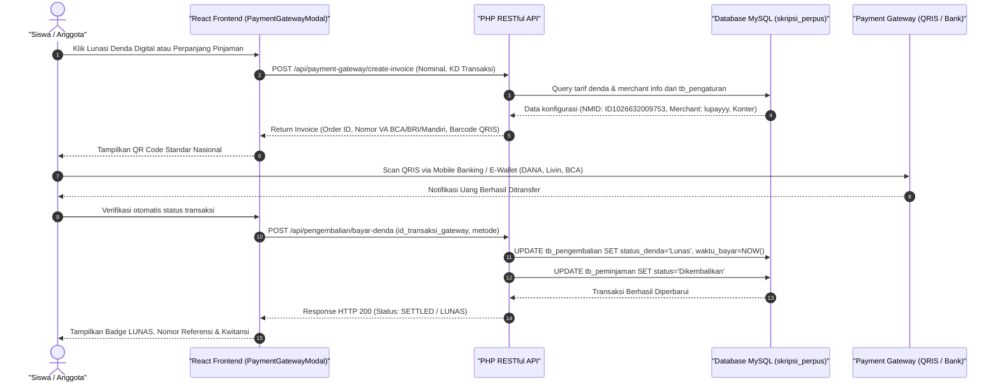

### 7.4 State Machine Diagram Siklus Status Pustaka
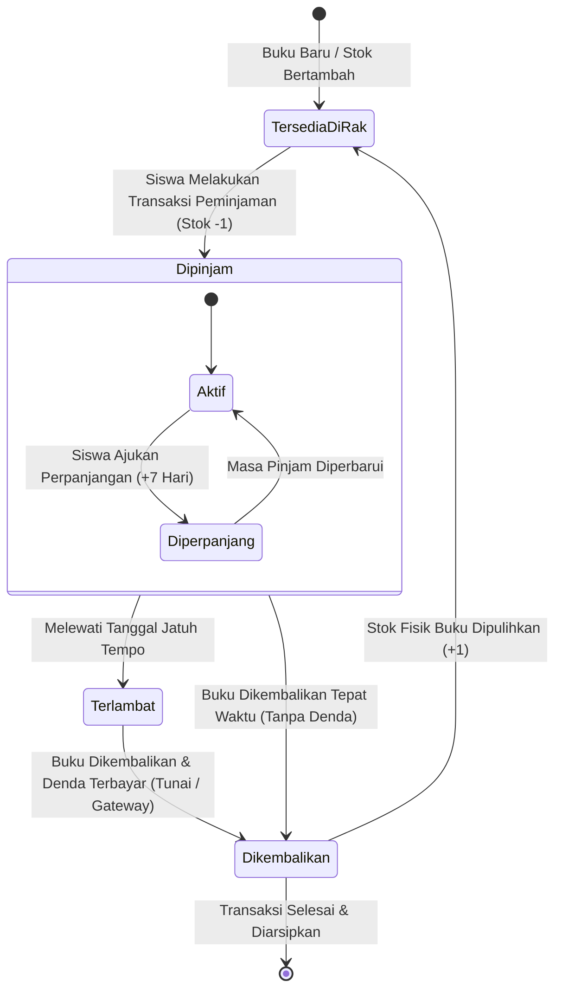

---

## 🧩 8. Class Diagram & Pemodelan Berorientasi Objek

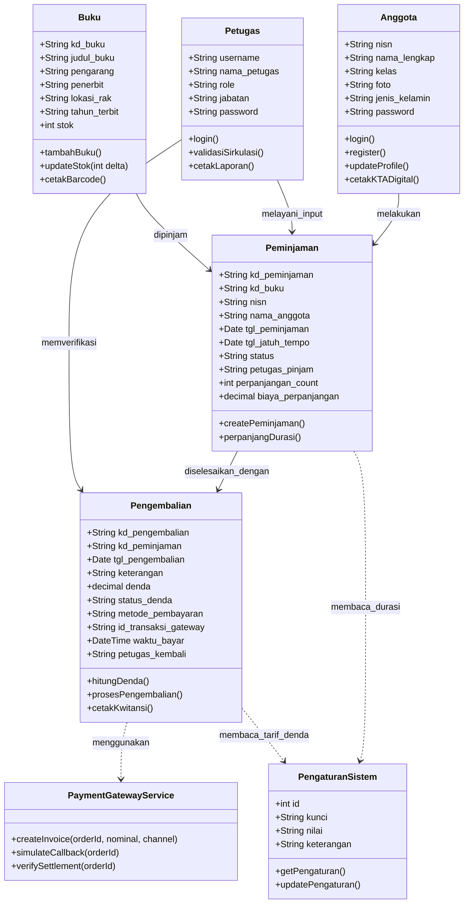

---

## 🧭 9. Standar Operasional Prosedur & Flowchart Sistem (7 Alur)

### A. Flowchart Sistem Berjalan vs Sistem Usulan
```mermaid
flowchart TD
    subgraph Flowchart_Sistem_Berjalan ["Sistem Berjalan (Konvensional Manual)"]
        SB_Start(["Mulai"]) --> SB_1[/"Siswa Menyerahkan Kartu & Buku Fisik"/]
        SB_1 --> SB_2["Petugas Mencari Kartu Anggota di Rak Dokumen"]
        SB_2 --> SB_3["Petugas Menulis di Buku Besar Peminjaman"]
        SB_3 --> SB_4{"Apakah Terjadi Keterlambatan?"}
        SB_4 -- "Ya" --> SB_5["Petugas Menghitung Denda Manual"]
        SB_4 -- "Tidak" --> SB_6["Buku Masuk Rak"]
        SB_5 --> SB_7[/"Siswa Membayar Tunai Fisik"/]
        SB_7 --> SB_8["Petugas Menulis Bukti di Kertas Bon"]
        SB_8 --> SB_End(["Selesai"])
        SB_6 --> SB_End
    end

    subgraph Flowchart_Sistem_Usulan ["Sistem Usulan (Modern Web Decoupled + QRIS)"]
        SU_Start(["Mulai"]) --> SU_1[/"Siswa / Petugas Input Kode Buku & NISN di Web"/]
        SU_1 --> SU_2[("Sistem Validasi Kuota 2 Buku & Stok Otomatis di MySQL")]
        SU_2 --> SU_3{"Data Valid & Stok Ada?"}
        SU_3 -- "Tidak" --> SU_Err[/"Tolak Transaksi & Munculkan Notifikasi"/]
        SU_3 -- "Ya" --> SU_4["Simpan Transaksi & Auto-Generate Kode PJxxx"]
        SU_4 --> SU_5{"Buku Dikembalikan?"}
        SU_5 -- "Ya" --> SU_6[("Engine Denda Hitung Otomatis via tb_pengaturan")]
        SU_6 --> SU_7{"Ada Denda Keterlambatan?"}
        SU_7 -- "Ya" --> SU_8[/"Pilihan Bayar: Tunai Loket / QRIS Payment Gateway"/]
        SU_8 --> SU_9["Konfirmasi Bayar & Pulihkan Stok +1"]
        SU_7 -- "Tidak" --> SU_9
        SU_9 --> SU_10[/"Cetak Kwitansi & Laporan Otomatis Bertanda Tangan"/]
        SU_10 --> SU_End(["Selesai"])
        SU_Err --> SU_End
    end
```

### B. Flowchart Login Multi-Role (RBAC)
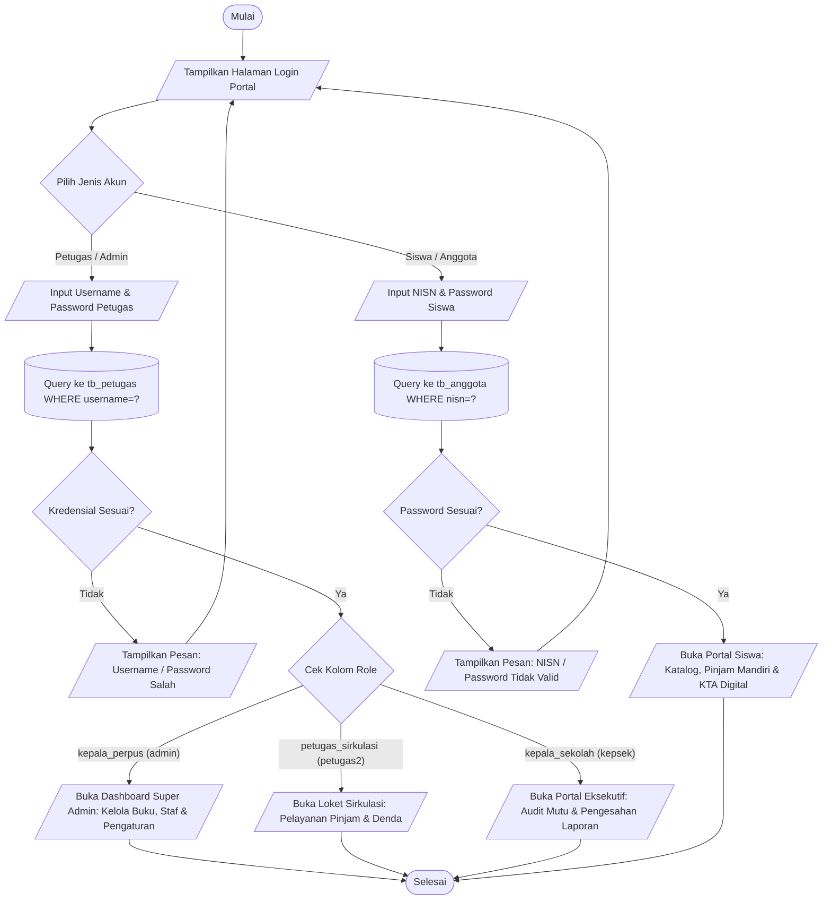

### C. Flowchart Transaksi Peminjaman Buku
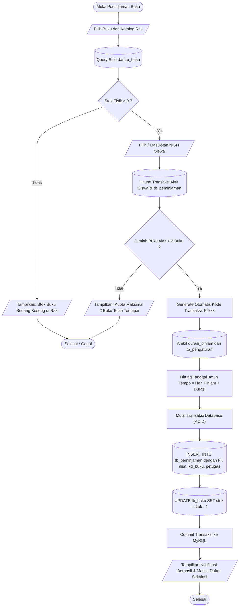

### D. Flowchart Pengembalian Buku & Perhitungan Denda Otomatis
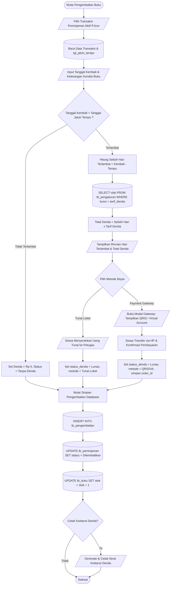

### E. Flowchart Pembayaran Digital Melalui Payment Gateway QRIS
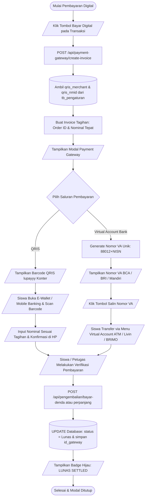

### F. Flowchart Perpanjangan Peminjaman Buku (+7 Hari)
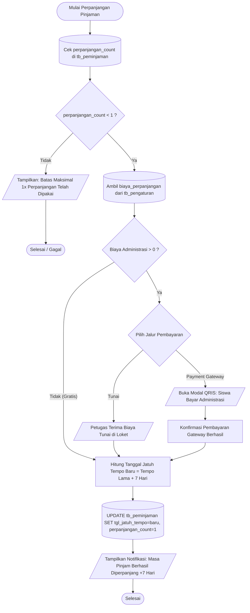

### G. Flowchart Pelaporan Eksekutif & Pengesahan Kepala Sekolah
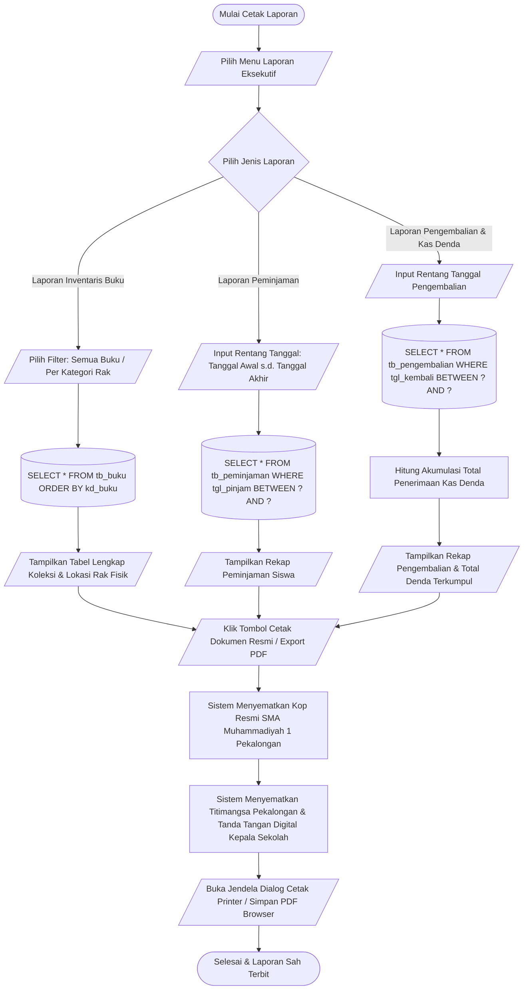

---

## 🚀 10. Panduan Instalasi, Menjalankan Aplikasi & Kredensial Demo

### A. Persiapan Basis Data (MySQL / phpMyAdmin)
1. Buka XAMPP Control Panel dan nyalakan modul **Apache** dan **MySQL** hingga berstatus `Running`.
2. Impor database skema dan dataset lengkap:
   ```powershell
   & "C:\xampp\mysql\bin\mysql.exe" -u root < "c:\semester 5\basis data lanjut\skripsi_perpus\backend\database\skripsi_perpus.sql"
   ```

### B. Menjalankan Backend RESTful API
```powershell
cd "c:\semester 5\basis data lanjut\skripsi_perpus\backend"
C:\xampp\php\php.exe -S 127.0.0.1:8000 -t public
```

### C. Menjalankan Frontend React (Vite SPA)
```powershell
cd "c:\semester 5\basis data lanjut\skripsi_perpus\frontend"
npm run dev
```
Aplikasi web siap diakses melalui peramban di: **`http://localhost:3000`**

### D. Kredensial Akun Pengujian Demo (Credentials)
| Peran (Role) | Username / NISN | Password | Wewenang Akses |
| :--- | :--- | :--- | :--- |
| **Kepala Unit Perpustakaan** | `admin` | `admin123` | Akses Penuh: Master buku, rak, denda, staf & laporan |
| **Petugas Sirkulasi Loket** | `petugas2` | `petugas123` | Pelayanan loket: Pinjam, kembali, denda tunai, barcode, WA |
| **Kepala Sekolah** | `kepsek` | `kepsek123` | Pengawasan mutu: Audit sirkulasi, kas denda & pengesahan laporan |
| **Siswa / Anggota** | `2024001` | `siswa123` | Portal mandiri: Katalog, pinjam mandiri, QRIS denda, cetak KTA |

---

## 🧪 11. Hasil Verifikasi Teknis & Pengujian Black Box Testing (17 Kasus)

### 11.1 Verifikasi Integritas MySQL Basis Data
Pengecekan integritas skema dan volume data baris dijalankan secara langsung pada MySQL database `skripsi_perpus`:
```sql
SELECT 'tb_buku' AS Entitas, COUNT(*) AS Total FROM tb_buku UNION ALL
SELECT 'tb_anggota', COUNT(*) FROM tb_anggota UNION ALL
SELECT 'tb_petugas', COUNT(*) FROM tb_petugas UNION ALL
SELECT 'tb_peminjaman', COUNT(*) FROM tb_peminjaman UNION ALL
SELECT 'tb_pengembalian', COUNT(*) FROM tb_pengembalian;
```
**Hasil Eksekusi:**
- `tb_buku`: **25 Baris** (Status: Valid, Berelasi Foreign Key)
- `tb_anggota`: **25 Baris** (Status: Valid, NISN Unique)
- `tb_petugas`: **3 Baris** (Status: Valid, RBAC Enkripsi Terverifikasi)
- `tb_peminjaman`: **25 Baris** (Status: Valid, Relasi Siswa & Koleksi Buku)
- `tb_pengembalian`: **20 Baris** (Status: Valid, Perhitungan Denda & QRIS Terhubung)

### 11.2 Verifikasi Kompilasi Frontend React (Vite Build)
Kompilasi kode sumber antarmuka dijalankan melalui perintah `npm run build` di lingkungan Node.js:
```bash
vite v5.4.21 building for production...
transforming...
✓ 1653 modules transformed.
dist/index.html                   0.78 kB │ gzip:   0.46 kB
dist/assets/index-DFwknTwe.css   64.71 kB │ gzip:  10.19 kB
dist/assets/index-Dfzq8zh-.js   472.52 kB │ gzip: 122.15 kB
✓ built in 4.60s
```
**Hasil:** Kompilasi berhasil 100% tanpa error (*Zero Warning, Zero Compilation Error*).

### 11.3 Pengujian Fungsional Black Box Testing (17 Skenario)

Pengujian fungsionalitas sistem menggunakan metode **Black Box Testing** dengan teknik *Equivalence Partitioning* dan *Boundary Value Analysis*:

| No | Kode Uji | Skenario Pengujian | Data Masukan (Input) | Hasil yang Diharapkan | Hasil Pengujian Aktual | Kesimpulan |
| :---: | :---: | :--- | :--- | :--- | :--- | :---: |
| 1 | **TC-01** | Autentikasi Petugas / Admin | Username: `admin`, Password: `admin123` | Sistem memvalidasi kredensial, membuat sesi, dan mengarahkan ke Dashboard Utama | Berhasil masuk ke Dashboard Unit Perpustakaan | **VALID** |
| 2 | **TC-02** | Autentikasi dengan Kredensial Salah | Username: `admin`, Password: `salahpassword` | Sistem menolak akses dan menampilkan pesan peringatan kredensial tidak valid | Sistem memblokir akses dan memunculkan toast error | **VALID** |
| 3 | **TC-03** | Pendaftaran Anggota Baru (Siswa) | NISN: `2024099`, Nama: `Budi Santoso`, Kelas: `XI IPA 1` | Record baru tersimpan di `tb_anggota` dan siswa dapat langsung login mandiri | Data tersimpan di database dan KTA digital langsung aktif | **VALID** |
| 4 | **TC-04** | Validasi Duplikasi NISN Anggota | NISN: `2024001` (sudah terdaftar) | Sistem mendeteksi Primary Key duplikat dan menolak penyimpanan record | Sistem menampilkan pesan "NISN sudah digunakan" | **VALID** |
| 5 | **TC-05** | Transaksi Peminjaman Buku Normal | Siswa: `2024001`, Buku: `BK001` (Stok: 5, Pinjam Aktif: 0) | Transaksi tercatat di `tb_peminjaman`, stok buku berkurang menjadi 4 | Transaksi berhasil, stok `tb_buku` otomatis terpotong -1 | **VALID** |
| 6 | **TC-06** | Validasi Kuota Maksimal Pinjam Siswa | Siswa telah meminjam 2 buku aktif, mengajukan pinjaman ke-3 | Sistem menolak transaksi pinjaman ke-3 sesuai SOP kuota maksimal perpustakaan | Muncul notifikasi: "Batas maksimal 2 buku aktif tercapai" | **VALID** |
| 7 | **TC-07** | Validasi Stok Buku Kosong | Meminjam buku dengan `stok = 0` | Sistem menolak transaksi peminjaman dan memberi peringatan stok fisik habis | Peminjaman dibatalkan dan form memberikan instruksi ke petugas | **VALID** |
| 8 | **TC-08** | Perpanjangan Peminjaman (+7 Hari) | Peminjaman aktif dengan `perpanjangan_count = 0` | Tanggal jatuh tempo bertambah +7 hari dan `perpanjangan_count` menjadi 1 | Tanggal tempo diperbarui dan tombol perpanjang terkunci (1x) | **VALID** |
| 9 | **TC-09** | Validasi Batas Maksimal Perpanjangan | Mengajukan perpanjangan kedua pada record dengan `count = 1` | Sistem menolak perpanjangan kedua | Sistem mengunci tombol dan membatasi kuota maksimal 1 kali | **VALID** |
| 10 | **TC-10** | Pengembalian Buku Tepat Waktu | Buku dikembalikan sebelum/pada tanggal jatuh tempo | `status_denda` = `Tanpa Denda`, `denda` = Rp 0, stok buku dipulihkan +1 | Denda otomatis Rp 0 dan stok fisik kembali bertambah | **VALID** |
| 11 | **TC-11** | Kalkulasi Denda Keterlambatan Otomatis | Terlambat 3 hari (Tarif: Rp 1.000/hari di `tb_pengaturan`) | Sistem menghitung denda: $3 \times \text{Rp } 1.000 = \text{Rp } 3.000$ | Nominal denda tertera tepat Rp 3.000 secara otomatis | **VALID** |
| 12 | **TC-12** | Pelunasan Denda via QRIS Gateway | Scan QRIS dan verifikasi pembayaran digital | Record `tb_pengembalian` di-update: `status_denda`='Lunas', simpan `id_gateway` | Transaksi otomatis lunas dan kwitansi resmi siap terbit | **VALID** |
| 13 | **TC-13** | Cetak Kartu Anggota (KTA) Digital | Klik tombol cetak KTA pada data siswa | Kartu siswa ter-render rapi lengkap dengan barcode NISN dan foto | Desain KTA standar nasional siap dicetak printer / PDF | **VALID** |
| 14 | **TC-14** | Cetak Struk Kwitansi Denda Resmi | Klik tombol cetak kwitansi pada transaksi lunas | Struk kwitansi memuat nomor transaksi, kop sekolah, dan rincian denda | Kwitansi resmi terbit dengan format termal/standar loket | **VALID** |
| 15 | **TC-15** | Pengesahan Laporan oleh Kepala Sekolah | Login peran `kepsek`, buka modul laporan, cetak | Dokumen laporan menyematkan kop surat resmi dan TTD Kepala Sekolah | Laporan terbit sah dengan nama Ahmad Marzuki, S.Pd.I | **VALID** |
| 16 | **TC-16** | Ekspor Laporan ke Spreadsheet / Excel | Klik tombol "Export ke Excel/CSV" | Berkas `.csv` otomatis terunduh dengan struktur kolom lengkap | File spreadsheet terunduh dan dapat dibuka sempurna di Excel | **VALID** |
| 17 | **TC-17** | Notifikasi Pengingat Jatuh Tempo WhatsApp | Klik tombol "Ingatkan WA" pada transaksi terlambat/H-1 | Membuka API WhatsApp dengan template pesan penagihan otomatis | Pesan peringatan terisi otomatis menuju nomor siswa | **VALID** |

---

## 👨‍🎓 12. Profil Penyusun

* **Perguruan Tinggi:** Universitas Muhammadiyah Metro
* **Fakultas / Program Studi:** S1 Ilmu Komputer / Sistem Informasi
* **Mata Kuliah / Tugas:** Basis Data Lanjut (Semester 5) / Tugas Akhir Skripsi
* **Tahun Akademik:** 2026 / 2027
* **Instansi Penelitian:** SMA Muhammadiyah 1 Pekalongan, Kab. Lampung Timur
* **Repositori GitHub:** [https://github.com/fanydarat757-hash/antigrafitytest](https://github.com/fanydarat757-hash/antigrafitytest)
