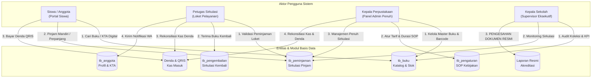

# 📋 MATRIKS HAK AKSES DAN ENTITAS SISTEM
## Sistem Informasi Manajemen Perpustakaan SMA Muhammadiyah 1 Pekalongan

> **Dokumen Spesifikasi Otorisasi & Relasi Entitas (RBAC - Role-Based Access Control)**  
> **Mata Kuliah:** Basis Data Lanjut & Tugas Akhir / Skripsi  
> **Instansi Mitra:** SMA Muhammadiyah 1 Pekalongan, Kabupaten Lampung Timur  

---

## 1. Definisi Pengguna / Aktor Sistem

Sistem Informasi Perpustakaan SMA Muhammadiyah 1 Pekalongan mengimplementasikan kendali akses berbasis peran (*Role-Based Access Control / RBAC*) yang ketat dengan 4 entitas pengguna utama:

1. **Kepala Unit Perpustakaan (`kepala_perpus` / Username: `admin`)**
   - **Pejabat:** Siti Farida, A.Md
   - **Peranan:** Administrator Utama / Manajerial Perpustakaan.
   - **Tanggung Jawab:** Pengelolaan katalog master buku, inventarisasi koleksi baru, manajemen data anggota dan staf, penetapan kebijakan operasional perpustakaan (tarif denda per hari, masa durasi pinjam standar, biaya administrasi perpanjangan) pada tabel `tb_pengaturan`, monitoring rekapitulasi denda, serta pencetakan laporan berkala.

2. **Petugas Layanan & Sirkulasi (`petugas_sirkulasi` / Username: `petugas2`)**
   - **Pejabat:** Samsul Arifin, S.Pd
   - **Peranan:** Operator Loket Front-Desk Sirkulasi.
   - **Tanggung Jawab:** Melayani peminjaman buku harian siswa, validasi kuota pinjam maksimal 2 buku aktif, pengecekan fisik buku saat pengembalian, kalkulasi denda otomatis, penyesuaian/dispensasi denda saat pengembalian, penerimaan pembayaran denda (Tunai di Loket maupun verifikasi QRIS), pencetakan bukti kwitansi sah, dan pengiriman notifikasi pengingat via WhatsApp Gateway kepada siswa yang menunggak.

3. **Kepala Sekolah / Supervisor Eksekutif (`kepala_sekolah` / Username: `kepsek`)**
   - **Pejabat:** Ahmad Marzuki, S.Pd.I
   - **Peranan:** Supervisor Eksekutif & Penjamin Mutu (*Executive Supervisor*).
   - **Tanggung Jawab:** Mengawasi indikator kinerja utama (KPI) literasi dan minat baca siswa, mengaudit inventaris koleksi buku sekolah secara *read-only*, serta melakukan **Pengesahan Resmi Laporan Perpustakaan** dengan membubuhkan tanda tangan digital dan stempel sekolah pada dokumen laporan untuk keperluan akreditasi sekolah.

4. **Siswa / Anggota Perpustakaan (`siswa` / Login: NISN)**
   - **Pengguna:** Seluruh siswa terdaftar di SMA Muhammadiyah 1 Pekalongan (25 Akun Anggota Aktif).
   - **Peranan:** Pengguna Layanan Mandiri (*Self-Service Portal*).
   - **Tanggung Jawab:** Mencari katalog buku dan letak rak fisiknya, mendaftar akun anggota secara mandiri, mengunduh Kartu Tanda Anggota (KTA) digital ber-barcode NISN, memantau riwayat peminjaman buku, memperpanjang masa pinjam secara mandiri, dan melunasi denda keterlambatan melalui scan QRIS Nasional.

---

## 2. Entitas Basis Data Sistem

Sistem dirancang memenuhi kaidah **Normalisasi Bentuk Ketiga (3NF)** dengan integritas referensial ACID menggunakan storage engine InnoDB MySQL:

| Nama Tabel / Entitas | Deskripsi Entitas | Kunci Utama (Primary Key) | Foreign Key / Relasi |
| :--- | :--- | :--- | :--- |
| **`tb_buku`** | Master katalog koleksi buku fisik perpustakaan | `kd_buku` (VARCHAR 11) | - |
| **`tb_anggota`** | Master data siswa dan anggota perpustakaan | `nisn` (VARCHAR 20) | - |
| **`tb_petugas`** | Master kredensial akun staf dan level peran | `username` (VARCHAR 30) | - |
| **`tb_peminjaman`** | Transaksi peminjaman buku dan perpanjangan | `kd_peminjaman` (VARCHAR 11) | `kd_buku` ➔ `tb_buku` `nisn` ➔ `tb_anggota` `petugas_pinjam` ➔ `tb_petugas` |
| **`tb_pengembalian`** | Transaksi pengembalian buku dan denda | `kd_pengembalian` (VARCHAR 11) | `kd_peminjaman` ➔ `tb_peminjaman` `petugas_kembali` ➔ `tb_petugas` |
| **`tb_pengaturan`** | Konfigurasi kebijakan tarif denda & SOP sistem | `id` (INT Auto Increment) | `diubah_oleh` ➔ `tb_petugas` |

---

## 3. Matriks Hak Akses CRUD Entitas (Entity-Role Matrix)

Berikut adalah matriks relasi Create (C), Read (R), Update (U), dan Delete (D) untuk setiap aktor terhadap entitas basis data:

| Entitas Basis Data / Modul | Kepala Perpustakaan (`admin`) | Petugas Sirkulasi (`petugas2`) | Kepala Sekolah (`kepsek`) | Siswa / Anggota (`siswa`) |
| :--- | :---: | :---: | :---: | :---: |
| **`tb_buku` (Master Koleksi Buku)** | **C, R, U, D** | **R** | **R** | **R** |
| **`tb_anggota` (Data Siswa/Anggota)** | **C, R, U, D** | **R, U** | **R** | **C, R, U\*** |
| **`tb_petugas` (Akun Staf & RBAC)** | **C, R, U, D** | **R, U\*** | **R** | **-** |
| **`tb_peminjaman` (Transaksi Pinjam)** | **C, R, U, D** | **C, R, U** | **R** | **C\*, R\*** |
| **`tb_pengembalian` (Pengembalian)** | **C, R, U, D** | **C, R, U** | **R** | **R\*** |
| **`tb_pengaturan` (Konfigurasi SOP)** | **C, R, U, D** | **R, U** | **R** | **R** |
| **Modul Denda & Kwitansi** | **C, R, U, D** | **C, R, U** | **R** | **R\*, Pay** |
| **Laporan & Dokumen Resmi** | **R, Export, Print** | **R, Export, Print** | **R, Export, Sign** | **R\*** |

*\*Catatan Khusus Operasional:*
- `C, R, U*` pada Siswa untuk `tb_anggota`: Siswa hanya dapat mendaftar mandiri (C) serta membaca dan memperbarui data profil/foto miliknya sendiri (R, U).
- `R, U*` pada Petugas untuk `tb_petugas`: Petugas hanya dapat mengedit nama dan foto profil miliknya sendiri, tidak dapat mengubah role akun lain.
- `C*, R*` pada Siswa untuk `tb_peminjaman` & `tb_pengembalian`: Siswa hanya dapat mengajukan perpanjangan/peminjaman mandiri dan melihat riwayat transaksinya sendiri.
- `R*` pada Siswa untuk Modul Denda & Laporan: Siswa hanya dapat melihat tagihan denda dan mencetak bukti kwitansi miliknya sendiri.

---

## 4. Matriks Fitur Operasional Lanjutan (Extended Permissions Matrix)

| Fitur Fungsional Spesifik | Kepala Perpus | Petugas Sirkulasi | Kepala Sekolah | Siswa / Anggota |
| :--- | :---: | :---: | :---: | :---: |
| **1. Tambah / Edit / Hapus Master Buku** | ✅ Ya | ❌ Tidak | ❌ Tidak | ❌ Tidak |
| **2. Generate Barcode Buku (Code 128)** | ✅ Ya | ✅ Ya | ❌ Tidak | ❌ Tidak |
| **3. Unduh Katalog Buku ke CSV/Excel** | ✅ Ya | ✅ Ya | ✅ Ya | ❌ Tidak |
| **4. Input Transaksi Peminjaman Baru** | ✅ Ya | ✅ Ya | ❌ Tidak | ✅ Ya (Mandiri) |
| **5. Beri Dispensasi Kuota (> 2 Buku)** | ✅ Ya | ✅ Ya | ❌ Tidak | ❌ Tidak |
| **6. Perpanjang Masa Pinjam (+7 Hari)** | ✅ Ya | ✅ Ya | ❌ Tidak | ✅ Ya (Maks 1x) |
| **7. Override Tanggal Jatuh Tempo Kustom** | ✅ Ya | ✅ Ya | ❌ Tidak | ❌ Tidak |
| **8. Edit / Bebaskan Denda (Dispensasi Rp 0)** | ✅ Ya | ✅ Ya | ❌ Tidak | ❌ Tidak |
| **9. Edit Denda pada Riwayat yang Sudah Ada** | ✅ Ya | ✅ Ya | ❌ Tidak | ❌ Tidak |
| **10. Cetak Bukti Kwitansi Denda Resmi** | ✅ Ya | ✅ Ya | ❌ Tidak | ✅ Ya (Struk Sendiri) |
| **11. Terima Pembayaran Tunai Loket** | ✅ Ya | ✅ Ya | ❌ Tidak | ❌ Tidak |
| **12. Pembayaran via QRIS Multi-Channel** | ✅ Ya | ✅ Ya | ❌ Tidak | ✅ Ya (Scan QRIS) |
| **13. Kirim Pengingat WhatsApp Tagihan** | ❌ Tidak | ✅ Ya (1-Klik WA) | ❌ Tidak | ❌ Tidak |
| **14. Cetak Kartu Anggota (KTA) Digital** | ✅ Ya | ✅ Ya | ❌ Tidak | ✅ Ya (KTA Sendiri) |
| **15. Ubah Tarif Denda Global (`tb_pengaturan`)** | ✅ Ya | ✅ Ya | ❌ Tidak | ❌ Tidak |
| **16. Filter Periode Tanggal Laporan** | ✅ Ya | ✅ Ya | ✅ Ya | ❌ Tidak |
| **17. Unduh Laporan Sirkulasi ke CSV/Excel** | ✅ Ya | ✅ Ya | ✅ Ya | ❌ Tidak |
| **18. Cetak Laporan Resmi Ber-KOP Sekolah** | ✅ Ya | ✅ Ya | ✅ Ya | ❌ Tidak |
| **19. Pengesahan & Tanda Tangan Digital Dokumen** | ❌ Tidak | ❌ Tidak | ✅ Ya (Otoritas Utama) | ❌ Tidak |
| **20. Manajemen Akun Staf Petugas** | ✅ Ya | ❌ Tidak | ❌ Tidak | ❌ Tidak |

---

## 5. Ringkasan Volume Data Dummy (Data Seed)

Basis data telah dimuat dengan dataset awal yang representatif, realistis, dan berstandar nasional untuk keperluan pengujian fungsional dan sidang skripsi:

1. **Master Koleksi Buku (`tb_buku`)**: **25 Judul Buku**
   - Kategori MIPA & Sains: 8 Judul (Matematika, Fisika, Biologi, Kimia, Astronomi, OSN)
   - Kategori Kemuhammadiyahan & Agama: 5 Judul (Kemuhammadiyahan X & XI, Tarjih, SKI, Tafsir)
   - Kategori Sosial & Humaniora: 4 Judul (Sosiologi, Geografi, Ekonomi Akuntansi, PPKn)
   - Kategori Bahasa & Sastra: 3 Judul (Bahasa Indonesia Lanjut, English on Target)
   - Kategori Fiksi & Karya Sastra: 3 Judul (Laskar Pelangi, Bumi Manusia, Kapal Van der Wijck)
   - Kategori Teknologi & Vokasi: 2 Judul (Informatika Python, Desain Grafis)

2. **Master Anggota / Siswa (`tb_anggota`)**: **25 Siswa**
   - NISN terdaftar: `2024001` sampai `2024025`
   - Distribusi jenjang: Kelas X, XI, dan XII (Jurusan IPA dan IPS)
   - Password default: `siswa123`

3. **Transaksi Peminjaman (`tb_peminjaman`)**: **25 Transaksi**
   - Kode Transaksi: `PJ001` sampai `PJ025`
   - Status: 20 Transaksi `Dikembalikan`, 4 Transaksi `Dipinjam` aktif, dan 1 Transaksi `Terlambat` dengan perhitungan denda berjalan otomatis.

4. **Transaksi Pengembalian (`tb_pengembalian`)**: **20 Transaksi**
   - Kode Pengembalian: `KB001` sampai `KB020`
   - Status Denda: 11 Bebas Denda (Tepat Waktu / Dispensasi) dan 9 Denda Terbayar (via Tunai Loket & QRIS Standar Nasional).

5. **Master Petugas (`tb_petugas`)**: **3 Staf Resmi**
   - `admin` (Siti Farida, A.Md - Kepala Unit Perpustakaan)
   - `petugas2` (Samsul Arifin, S.Pd - Petugas Sirkulasi)
   - `kepsek` (Ahmad Marzuki, S.Pd.I - Kepala Sekolah)

---

## 6. Diagram Aliran Data Wewenang (Data Authorization Flow)

---
*Dokumen ini merupakan bagian tak terpisahkan dari naskah skripsi Bab 3 (Analisis & Perancangan Sistem) dan Bab 4 (Implementasi & Pengujian Sistem) Tugas Akhir Sistem Informasi Perpustakaan SMA Muhammadiyah 1 Pekalongan.*
