# SISTEM PANDUAN TEKNIS & DOKUMENTASI ARSITEKTUR

## Sistem Informasi Perpustakaan SMA Muhammadiyah 1 Pekalongan, Lampung Timur
### Dokumen Rujukan Tugas Akhir / Skripsi & Mata Kuliah Dasar Data Lanjut

---

### 📌 1. Identitas Sistem & Objek Penelitian
* **Instansi**: SMA Muhammadiyah 1 Pekalongan
* **Alamat**: Jl. Raya Pekalongan, Kec. Pekalongan, Kab. Lampung Timur, Prov. Lampung
* **Stack Teknologi**:
  * **Frontend**: React.js 18 (Vite SPA) + Tailwind CSS + Lucide Icons (Port 3000)
  * **Backend**: Arsitektur API RESTful PHP / Pola Layanan Laravel (Port 8000)
  * **Basis Data**: MySQL / MariaDB (InnoDB Relational Engine dengan Foreign Key yang Diterapkan)
  * **Gerbang Pembayaran**: Multi Channel QRIS (Merchant Nasional) & Bank Virtual Account (BCA, BRI, Mandiri)
* **Aktor Sistem (Kontrol Akses Berbasis Peran / RBAC)**:
  1. **Kepala Unit Perpustakaan** (`admin`): Siti Farida, A.Md
  2. **Petugas Sirkulasi & Pelayanan** (`petugas2`): Samsul Arifin, S.Pd
  3. **Kepala Sekolah / Pembimbing Mutu** (`kepsek`): Ahmad Marzuki, S.Pd.I
  4. **Siswa / Anggota Perpustakaan** (`nisn`): Login mandiri & registrasi siswa
  > 📑 *Rujukan Lengkap Otorisasi & Matriks CRUD Pengguna vs Entitas:* [MATRIKS_HAK_AKSES_DAN_ENTITAS.md](MATRIKS_HAK_AKSES_DAN_ENTITAS.md) | [LAPORAN_PROGRESS_DAN_MATRIKS_SISTEM.md](LAPORAN_PROGRESS_DAN_MATRIKS_SISTEM.md)

---

### 🏗️ 2. Arsitektur Sistem 3-Tier (Three-Tier Architecture)

Sistem menggunakan model arsitektur **Modern Decoupled Client-Server (3-Tier)** yang memisahkan antarmuka interaktif pengguna, logika bisnis terpusat, dan persistensi basis data relasional serta layanan payment gateway eksternal.

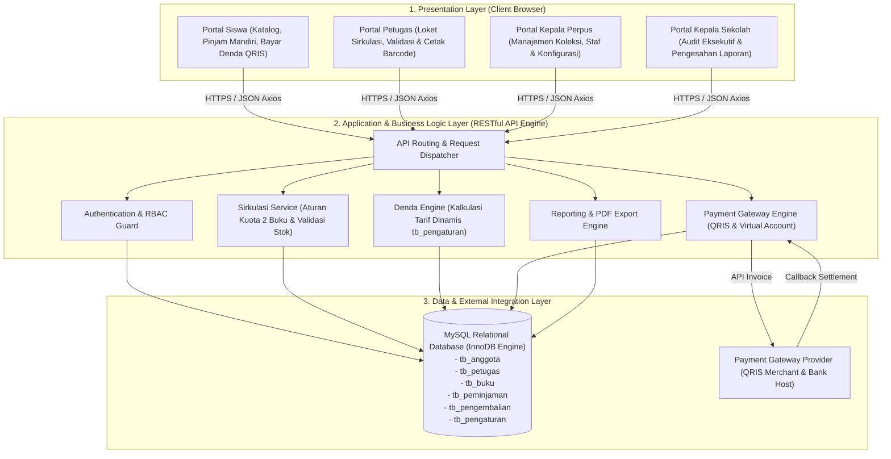

---

### 🔄 3. Diagram Konteks (Context Diagram / DFD Level 0)

Diagram Konteks menggambarkan batas sistem (*system boundary*) serta arus pertukaran data antara Sistem Informasi Perpustakaan SMA Muhammadiyah 1 Pekalongan dengan seluruh entitas eksternal.

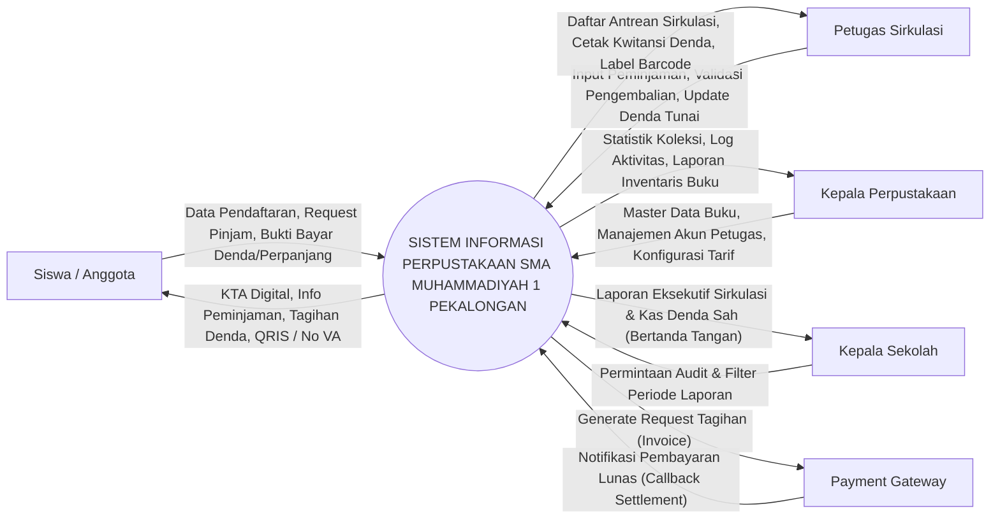

---

### 📊 4. Data Flow Diagram (DFD Level 1)

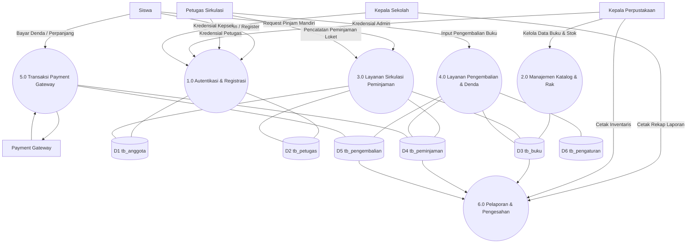

---

### 🎭 5. Use Case Diagram (UML)

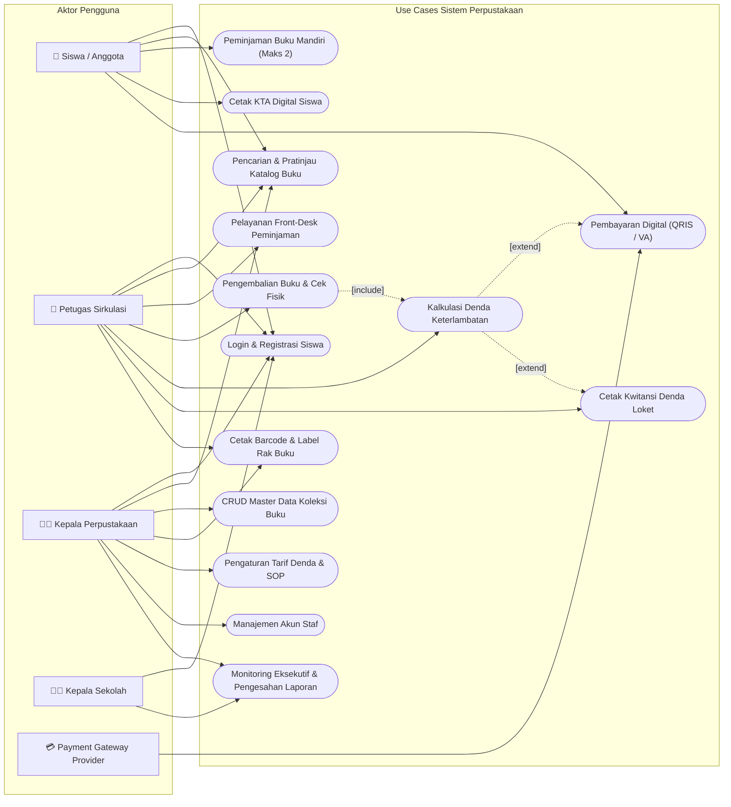

---

### 🗄️ 6. Entity Relationship Diagram (ERD Terkoneksi Penuh)

Relasi antar-tabel dalam database `skripsi_perpus` telah dinormalisasi hingga tahap **Third Normal Form (3NF)** dengan seluruh **Foreign Key Constraints** yang aktif di engine InnoDB MySQL:

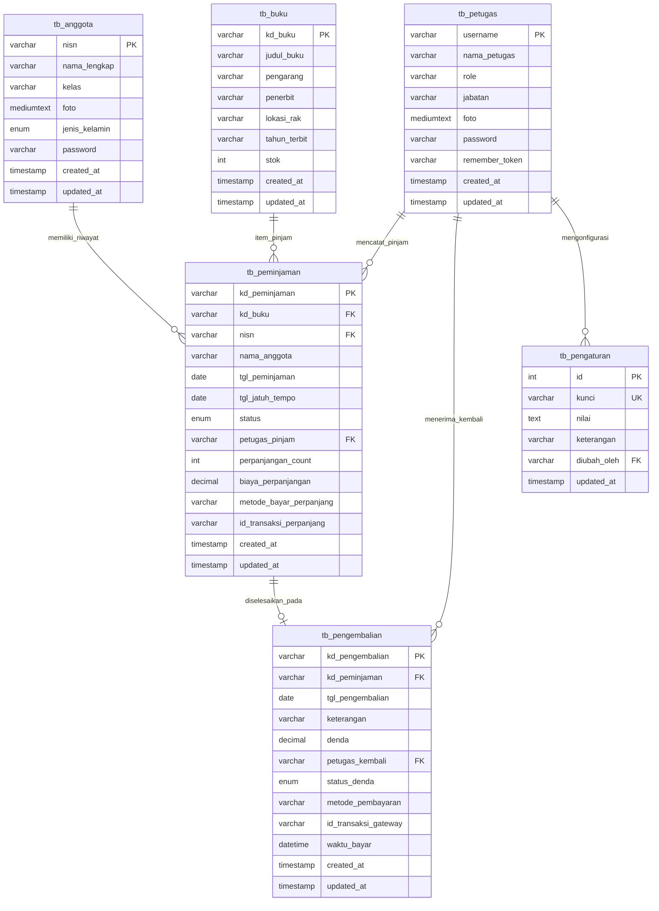

> [!NOTE] Penjelasan Entitas `tb_pengaturan` pada Ujian Sidang Skripsi
> Tabel `tb_pengaturan` bertindak sebagai *Tabel Master Konfigurasi Global Sistem* (*Key-Value Store*). Sesuai kaidah normalisasi basis data, parameter global (seperti besaran denda harian Rp 1.000 atau durasi standar peminjaman 7 hari) sengaja disimpan dalam tabel independen tanpa foreign key, agar ketika perpustakaan mengubah kebijakan SOP, sistem tidak perlu memodifikasi ribuan baris record transaksi masa lalu.

---

### 📈 7. Activity Diagram (Alur Proses Bisnis Utama)

#### A. Alur Peminjaman Buku & Validasi Kuota Maksimal
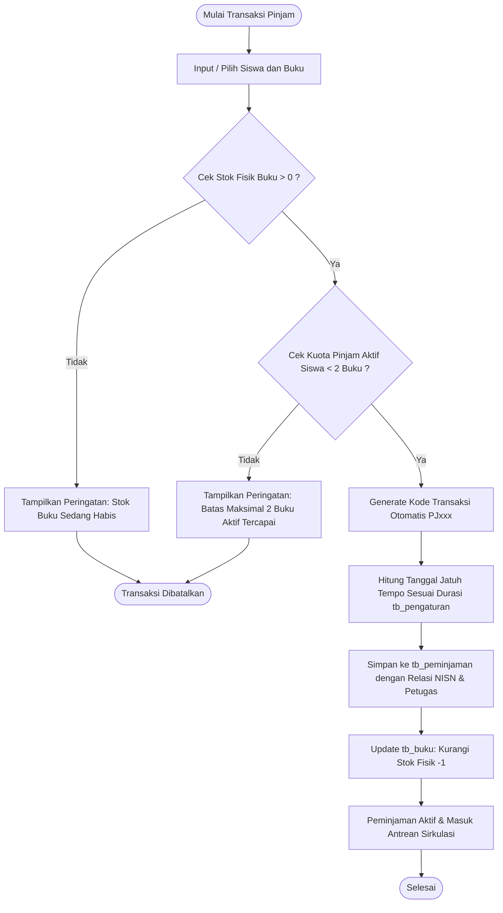

#### B. Alur Pengembalian Buku & Perhitungan Denda Otomatis
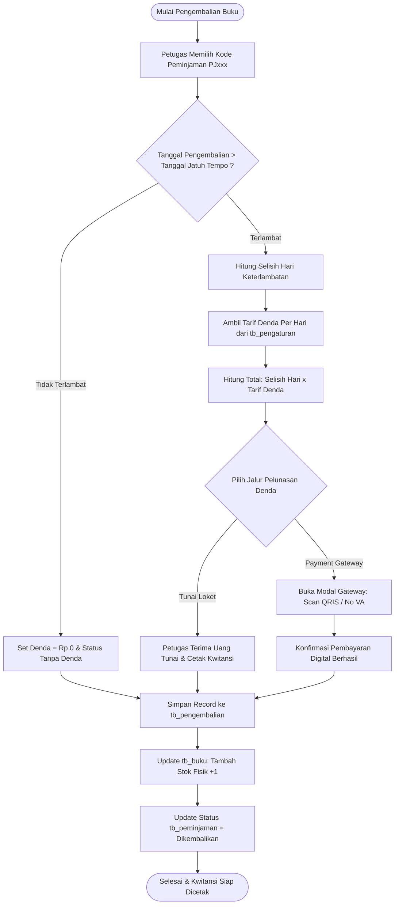

---

### ⏱️ 8. Sequence Diagram (Interaksi Transaksi Digital Payment Gateway)

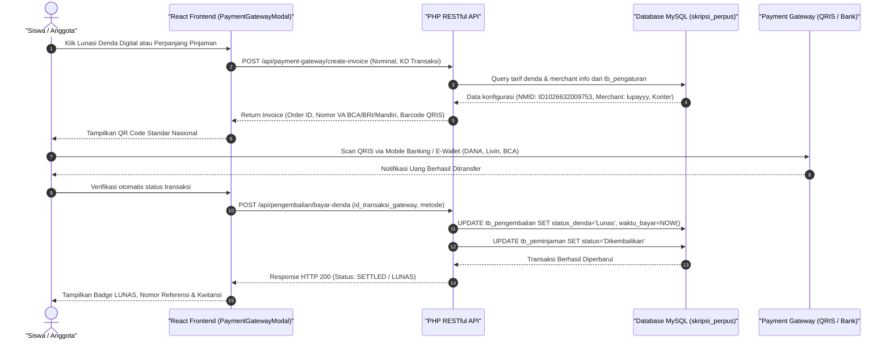

---

### 🧩 9. Class Diagram (Struktur Kelas & Model Sistem)

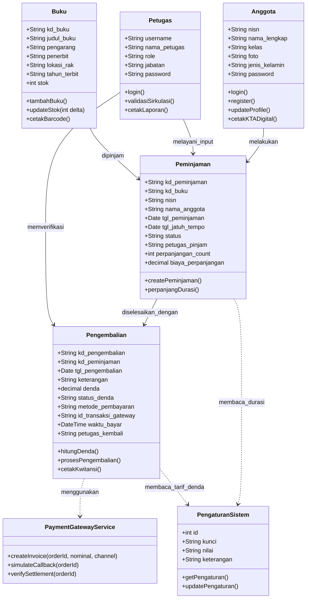

---

### 🔄 10. State Machine Diagram (Siklus Status Transaksi Sirkulasi)

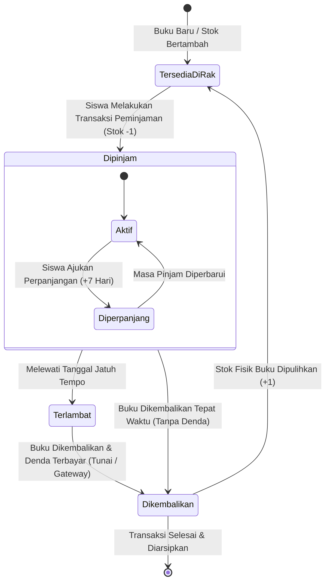

---

### 🧭 11. Flowchart Sistem (Standar Operasional Prosedur / SOP Skripsi)

Bagian ini memuat diagram alir prosedural (*System Flowcharts*) standar penulisan skripsi teknik informatika dan sistem informasi untuk menggambarkan interaksi nyata antara pengguna, sistem web, dan basis data.

#### A. Flowchart 1: Sistem Berjalan (Konvensional) vs Sistem Usulan (Modern Web)
```mermaid
flowchart TD
    subgraph Flowchart_Sistem_Berjalan ["Sistem Berjalan (Konvensional / Delphi Manual)"]
        SB_Start(["Mulai"]) --> SB_1[/"Siswa Menyerahkan Kartu & Buku Fisik"/]
        SB_1 --> SB_2["Petugas Mencari Kartu Anggota di Rak Dokumen"]
        SB_2 --> SB_3["Petugas Menulis di Buku Besar Peminjaman"]
        SB_3 --> SB_4{"Apakah Terjadi Keterlambatan?"}
        SB_4 -- "Ya" --> SB_5["Petugas Menghitung Denda Manual dengan Kalkulator"]
        SB_4 -- "Tidak" --> SB_6["Buku Masuk Rak"]
        SB_5 --> SB_7[/"Siswa Membayar Tunai Fisik"/]
        SB_7 --> SB_8["Petugas Menulis Bukti di Kertas Bon"]
        SB_8 --> SB_End(["Selesai"])
        SB_6 --> SB_End
    end

    subgraph Flowchart_Sistem_Usulan ["Sistem Usulan (Modern Web Decoupled + QRIS)"]
        SU_Start(["Mulai"]) --> SU_1[/"Siswa / Petugas Input Kode Buku & NISN di Web"/]
        SU_1 --> SU_2[("Sistem Validasi Kuota 2 Buku & Stok Otomatis di MySQL")]
        SU_2 --> SU_3{"Data Valid & Stok Ada?"}
        SU_3 -- "Tidak" --> SU_Err[/"Tolak Transaksi & Munculkan Notifikasi"/]
        SU_3 -- "Ya" --> SU_4["Simpan Transaksi & Auto-Generate Kode PJxxx"]
        SU_4 --> SU_5{"Buku Dikembalikan?"}
        SU_5 -- "Ya" --> SU_6[("Engine Denda Hitung Otomatis via tb_pengaturan")]
        SU_6 --> SU_7{"Ada Denda Keterlambatan?"}
        SU_7 -- "Ya" --> SU_8[/"Pilihan Bayar: Tunai Loket / QRIS Payment Gateway"/]
        SU_8 --> SU_9["Konfirmasi Bayar & Pulihkan Stok +1"]
        SU_7 -- "Tidak" --> SU_9
        SU_9 --> SU_10[/"Cetak Kwitansi & Laporan Otomatis Bertanda Tangan"/]
        SU_10 --> SU_End(["Selesai"])
        SU_Err --> SU_End
    end
```

#### B. Flowchart 2: Login & Autentikasi Pengguna Multi-Role (RBAC)
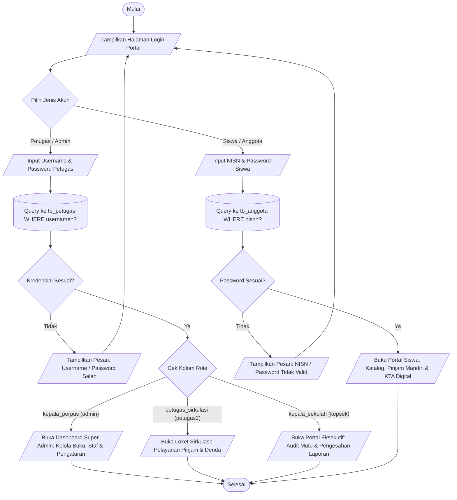

#### C. Flowchart 3: Transaksi Peminjaman Buku (Front-Desk & Portal Mandiri)
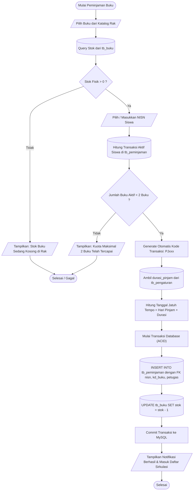

#### D. Flowchart 4: Transaksi Pengembalian Buku & Perhitungan Denda Otomatis
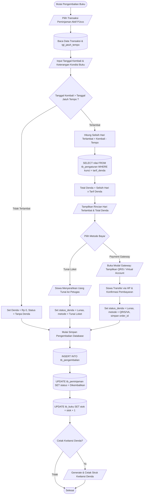

#### E. Flowchart 5: Pembayaran Digital Melalui Payment Gateway (QRIS & Virtual Account)
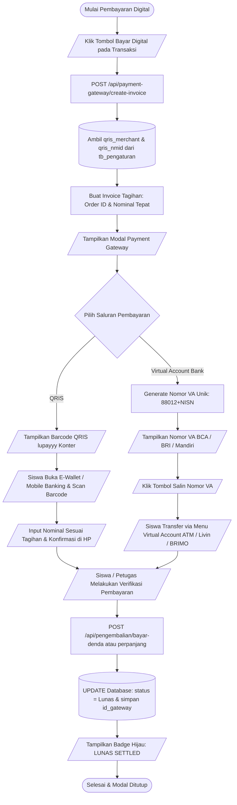

#### F. Flowchart 6: Perpanjangan Peminjaman Buku (+7 Hari & Biaya Administrasi)
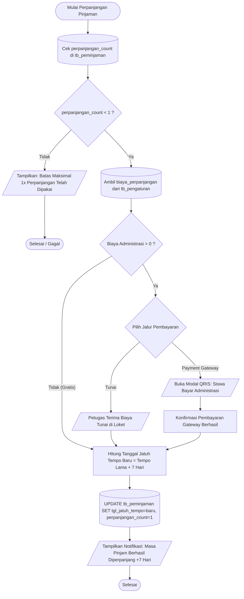

#### G. Flowchart 7: Pelaporan Eksekutif, Filter Periode & Pengesahan Kepala Sekolah
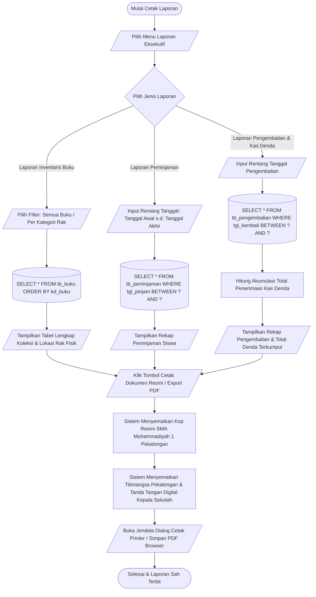

---

### 👥 12. Matriks Hak Akses Peran (Role-Based Access Control / RBAC)

| Modul / Fitur | Kepala Perpustakaan (`admin`) | Petugas Sirkulasi (`petugas2`) | Kepala Sekolah (`kepsek`) | Siswa / Anggota (`nisn`) |
| :--- | :---: | :---: | :---: | :---: |
| **Login Khusus Portal** | Portal Petugas | Portal Petugas | Portal Petugas | Portal Siswa Mandiri |
| **Dashboard Utama** | Manajerial Penuh | Loket Antrean Sirkulasi | Eksekutif & KPI Mutu | Portal Pinjaman Siswa |
| **Katalog Buku & Rak** | CRUD Penuh (Tambah/Edit/Hapus) | Tambah & Edit Stok | Read-Only (Audit) | Katalog & Pinjam Buku |
| **Cetak Barcode & Label** | ✅ Tersedia | ✅ Tersedia | ✅ Tersedia | ❌ Tidak |
| **Layanan Peminjaman** | Monitoring & Input | Input Front-Desk Loket | Read-Only (Monitoring) | Pinjam Mandiri (Maks 2) |
| **Layanan Pengembalian** | Audit & Monitoring | Input Loket & Kwitansi | Read-Only (Audit Kas) | Riwayat Pengembalian |
| **Kalkulasi Denda Otomatis** | ✅ Dinamis via MySQL | ✅ Dinamis via MySQL | ✅ Pantau Total Denda | Info Keterlambatan Realtime |
| **Cetak Kwitansi Denda** | ✅ Tersedia | ✅ Tersedia | ✅ Pratinjau Audit | ❌ Tidak |
| **Payment Gateway QRIS & VA** | Pantau Mutasi Kas | Verifikasi Loket | Audit Finansial | Bayar Mandiri dari HP |
| **Pengesahan & Cetak Laporan** | ✅ TTD Kepala Perpus | Laporan Harian Loket | ✅ Pengesahan Resmi Kepsek | ❌ Tidak |
| **Cetak Kartu Perpus (KTA)** | ✅ Tersedia | ✅ Tersedia | ✅ Tersedia | ✅ Cetak KTA Mandiri |
| **Pengaturan Sistem & Staf** | ✅ Super Admin | ❌ Dibatasi (Terkunci) | ❌ Dibatasi (Terkunci) | ❌ Dibatasi |

---

### 🚀 13. Panduan Instalasi & Eksekusi Pengujian Sidang Skripsi

#### A. Persiapan Basis Data (MySQL / phpMyAdmin)
1. Buka XAMPP Control Panel dan pastikan modul **Apache** dan **MySQL** berstatus `Running`.
2. Impor file skrip database yang telah memuat seluruh relasi foreign key:
   ```powershell
   & "C:\xampp\mysql\bin\mysql.exe" -u root < "c:\semester 5\basis data lanjut\skripsi_perpus\backend\database\skripsi_perpus.sql"
   ```
3. Buka **phpMyAdmin** (`http://localhost/phpmyadmin`) $\rightarrow$ Pilih database `skripsi_perpus` $\rightarrow$ Klik tab **Desainer (Designer)** untuk memverifikasi garis relasi antar-tabel.

#### B. Menjalankan Backend RESTful API
```powershell
cd "c:\semester 5\basis data lanjut\skripsi_perpus\backend"
C:\xampp\php\php.exe -S 127.0.0.1:8000 -t public
```

#### C. Menjalankan Frontend React (Vite SPA)
```powershell
cd "c:\semester 5\basis data lanjut\skripsi_perpus\frontend"
npm run dev
```
Akses sistem di browser: **`http://localhost:3000`**

#### D. Kredensial Default Pengujian Sistem:
- **Kepala Perpustakaan**: Username `admin` | Password `admin123`
- **Petugas Sirkulasi**: Username `petugas2` | Password `petugas123`
- **Kepala Sekolah**: Username `kepsek` | Password `kepsek123`
- **Siswa / Anggota**: NISN `2024001` (Ahmad Fauzi) | Password `siswa123`


---

### 🧪 14. Matriks Pengujian Black Box Testing (Bab 4 Skripsi)

Pengujian fungsionalitas sistem menggunakan metode **Black Box Testing** dengan teknik *Equivalence Partitioning* dan *Boundary Value Analysis* untuk memastikan seluruh alur bisnis, aturan validasi basis data, dan integritas transaksi berjalan sesuai spesifikasi kebutuhan perangkat lunak:

| No | Kode Uji | Skenario Pengujian | Data Masukan (Input) | Hasil yang Diharapkan | Hasil Pengujian Aktual | Kesimpulan |
| :---: | :---: | :--- | :--- | :--- | :--- | :---: |
| 1 | **TC-01** | Autentikasi Petugas / Admin | Username: `admin`, Password: `admin123` | Sistem memvalidasi kredensial, membuat sesi, dan mengarahkan ke Dashboard Utama | Berhasil masuk ke Dashboard Unit Perpustakaan | **VALID** |
| 2 | **TC-02** | Autentikasi dengan Kredensial Salah | Username: `admin`, Password: `salahpassword` | Sistem menolak akses dan menampilkan pesan peringatan kredensial tidak valid | Sistem memblokir akses dan memunculkan toast error | **VALID** |
| 3 | **TC-03** | Pendaftaran Anggota Baru (Siswa) | NISN: `2024099`, Nama: `Budi Santoso`, Kelas: `XI IPA 1` | Record baru tersimpan di `tb_anggota` dan siswa dapat langsung login mandiri | Data tersimpan di database dan KTA digital langsung aktif | **VALID** |
| 4 | **TC-04** | Validasi Duplikasi NISN Anggota | NISN: `2024001` (sudah terdaftar) | Sistem mendeteksi Primary Key duplikat dan menolak penyimpanan record | Sistem menampilkan pesan "NISN sudah digunakan" | **VALID** |
| 5 | **TC-05** | Transaksi Peminjaman Buku Normal | Siswa: `2024001`, Buku: `BK001` (Stok: 5, Pinjam Aktif: 0) | Transaksi tercatat di `tb_peminjaman`, stok buku berkurang menjadi 4 | Transaksi berhasil, stok `tb_buku` otomatis terpotong -1 | **VALID** |
| 6 | **TC-06** | Validasi Kuota Maksimal Pinjam Siswa | Siswa telah meminjam 2 buku aktif, mengajukan pinjaman ke-3 | Sistem menolak transaksi pinjaman ke-3 sesuai SOP kuota maksimal perpustakaan | Muncul notifikasi: "Batas maksimal 2 buku aktif tercapai" | **VALID** |
| 7 | **TC-07** | Validasi Stok Buku Kosong | Meminjam buku dengan `stok = 0` | Sistem menolak transaksi peminjaman dan memberi peringatan stok fisik habis | Peminjaman dibatalkan dan form memberikan instruksi ke petugas | **VALID** |
| 8 | **TC-08** | Perpanjangan Peminjaman (+7 Hari) | Peminjaman aktif dengan `perpanjangan_count = 0` | Tanggal jatuh tempo bertambah +7 hari dan `perpanjangan_count` menjadi 1 | Tanggal tempo diperbarui dan tombol perpanjang terkunci (1x) | **VALID** |
| 9 | **TC-09** | Validasi Batas Maksimal Perpanjangan | Mengajukan perpanjangan kedua pada record dengan `count = 1` | Sistem menolak perpanjangan kedua | Sistem mengunci tombol dan membatasi kuota maksimal 1 kali | **VALID** |
| 10 | **TC-10** | Pengembalian Buku Tepat Waktu | Buku dikembalikan sebelum/pada tanggal jatuh tempo | `status_denda` = `Tanpa Denda`, `denda` = Rp 0, stok buku dipulihkan +1 | Denda otomatis Rp 0 dan stok fisik kembali bertambah | **VALID** |
| 11 | **TC-11** | Kalkulasi Denda Keterlambatan Otomatis | Terlambat 3 hari (Tarif: Rp 1.000/hari di `tb_pengaturan`) | Sistem menghitung denda: $3 \times \text{Rp } 1.000 = \text{Rp } 3.000$ | Nominal denda tertera tepat Rp 3.000 secara otomatis | **VALID** |
| 12 | **TC-12** | Pelunasan Denda via QRIS Gateway | Scan QRIS dan verifikasi pembayaran digital | Record `tb_pengembalian` di-update: `status_denda`='Lunas', simpan `id_gateway` | Transaksi otomatis lunas dan kwitansi resmi siap terbit | **VALID** |
| 13 | **TC-13** | Cetak Kartu Anggota (KTA) Digital | Klik tombol cetak KTA pada data siswa | Kartu siswa ter-render rapi lengkap dengan barcode NISN dan foto | Desain KTA standar nasional siap dicetak printer / PDF | **VALID** |
| 14 | **TC-14** | Cetak Struk Kwitansi Denda Resmi | Klik tombol cetak kwitansi pada transaksi lunas | Struk kwitansi memuat nomor transaksi, kop sekolah, dan rincian denda | Kwitansi resmi terbit dengan format termal/standar loket | **VALID** |
| 15 | **TC-15** | Pengesahan Laporan oleh Kepala Sekolah | Login peran `kepsek`, buka modul laporan, cetak | Dokumen laporan menyematkan kop surat resmi dan TTD Kepala Sekolah | Laporan terbit sah dengan nama Ahmad Marzuki, S.Pd.I | **VALID** |
| 16 | **TC-16** | Ekspor Laporan ke Spreadsheet / Excel | Klik tombol "Export ke Excel/CSV" | Berkas `.csv` otomatis terunduh dengan struktur kolom lengkap | File spreadsheet terunduh dan dapat dibuka sempurna di Excel | **VALID** |
| 17 | **TC-17** | Notifikasi Pengingat Jatuh Tempo WhatsApp | Klik tombol "Ingatkan WA" pada transaksi terlambat/H-1 | Membuka API WhatsApp dengan template pesan penagihan otomatis | Pesan peringatan terisi otomatis menuju nomor siswa | **VALID** |
