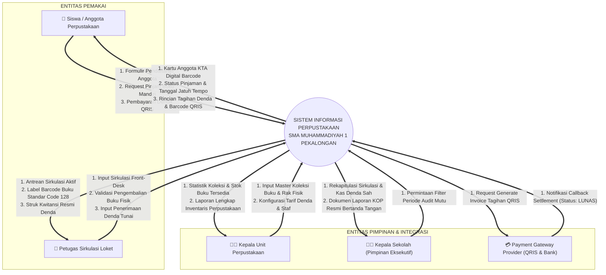
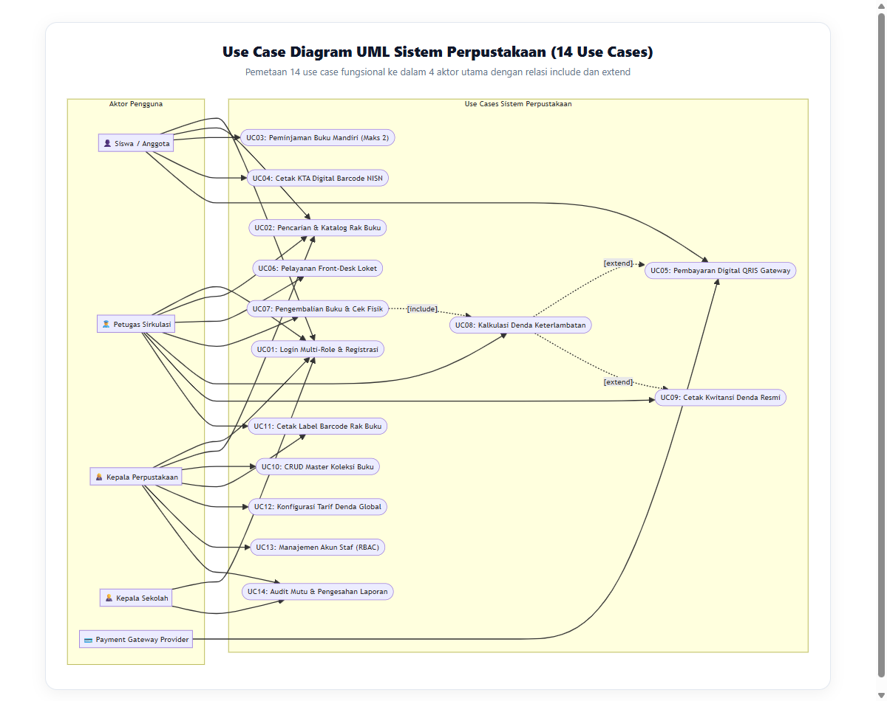
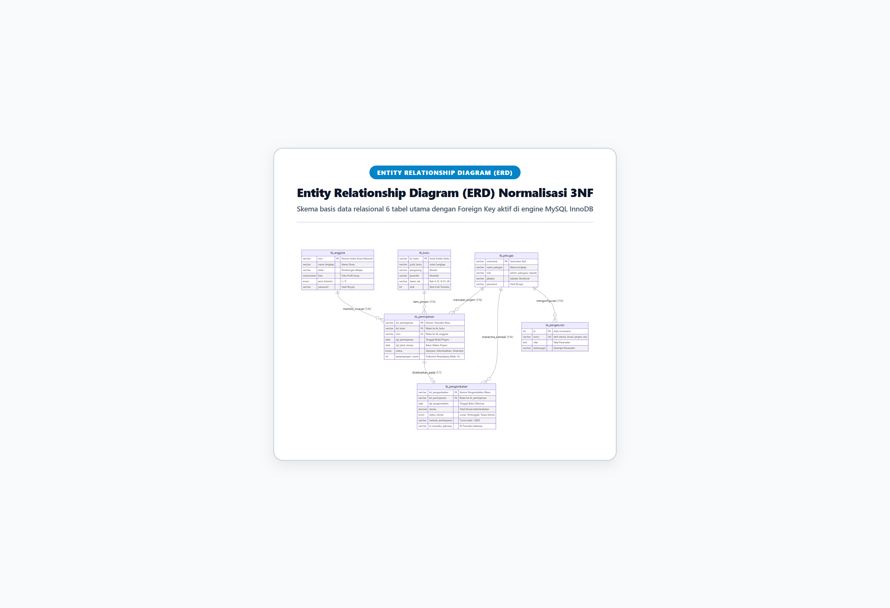
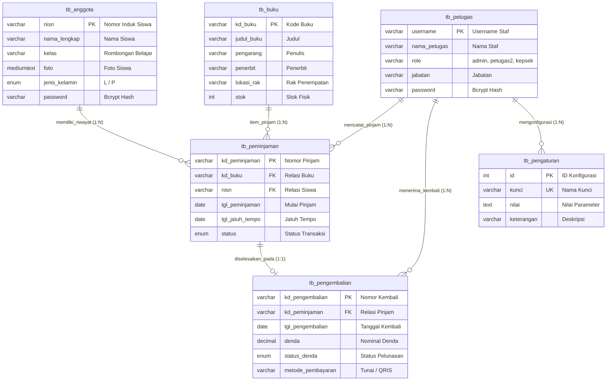
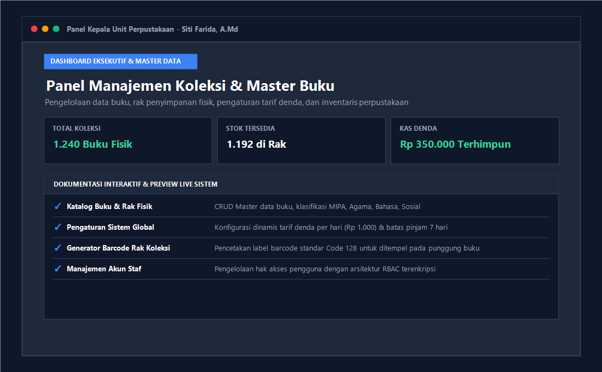
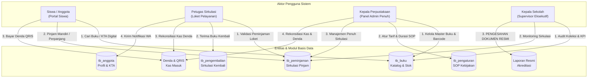

```mermaid
flowchart TD
    subgraph Aktor ["AKTOR PENGGUNA SISTEM"]
        A_Siswa["👤 Siswa / Anggota"]
        A_Petugas["👮 Petugas Sirkulasi"]
        A_Admin["👩‍💼 Kepala Perpustakaan"]
        A_Kepsek["👨‍💼 Kepala Sekolah"]
        A_PG["💳 Payment Gateway Provider"]
    end

    subgraph Modul_Auth ["1. MODUL AUTENTIKASI & REGISTRASI"]
        UC1(["UC01: Login Multi-Role & Registrasi Siswa"])
        UC2(["UC02: Pencarian & Katalog Rak Koleksi Buku"])
    end

    subgraph Modul_Sirkulasi ["2. MODUL LAYANAN SIRKULASI"]
        UC3(["UC03: Peminjaman Buku Mandiri (Maksimal 2 Buku)"])
        UC4(["UC04: Cetak Kartu Anggota KTA Digital Barcode NISN"])
        UC6(["UC06: Pelayanan Front-Desk Peminjaman Loket"])
        UC7(["UC07: Pengembalian Buku & Pemeriksaan Fisik"])
    end

    subgraph Modul_Finansial ["3. MODUL FINANSIAL & DENDA"]
        UC8(["UC08: Kalkulasi Denda Keterlambatan Otomatis"])
        UC5(["UC05: Pembayaran Digital via QRIS Gateway"])
        UC9(["UC09: Cetak Struk Kwitansi Resmi Pelunasan Denda"])
    end

    subgraph Modul_Manajerial ["4. MODUL MANAJERIAL & PELAPORAN"]
        UC10(["UC10: CRUD Master Data Koleksi Buku"])
        UC11(["UC11: Cetak Label Barcode Rak Buku Code 128"])
        UC12(["UC12: Konfigurasi Tarif Denda Global tb_pengaturan"])
        UC13(["UC13: Manajemen Akun Staf Perpustakaan (RBAC)"])
        UC14(["UC14: Audit Mutu & Pengesahan Laporan Eksekutif"])
    end

    A_Siswa --> UC1
    A_Siswa --> UC2
    A_Siswa --> UC3
    A_Siswa --> UC4
    A_Siswa --> UC5

    A_Petugas --> UC1
    A_Petugas --> UC2
    A_Petugas --> UC6
    A_Petugas --> UC7
    A_Petugas --> UC8
    A_Petugas --> UC9
    A_Petugas --> UC11

    A_Admin --> UC1
    A_Admin --> UC2
    A_Admin --> UC10
    A_Admin --> UC11
    A_Admin --> UC12
    A_Admin --> UC13
    A_Admin --> UC14

    A_Kepsek --> UC1
    A_Kepsek --> UC14

    UC7 -.->|"[include]"| UC8
    UC8 -.->|"[extend]"| UC5
    UC8 -.->|"[extend]"| UC9
    A_PG --> UC5
```

# 📚 Sistem Informasi Manajemen Perpustakaan SMA Muhammadiyah 1 Pekalongan Berbasis Web

[](https://react.dev)
[](https://vitejs.dev)
[](https://www.php.net)
[](https://www.mysql.com)
[](https://tailwindcss.com)
[](https://qris.id)
[](#)

> **Tugas Akhir / Skripsi & Basis Data Lanjut**  
> **Universitas Muhammadiyah Metro**  
> **Program Studi:** S1 Ilmu Komputer / Sistem Informasi  
> **Instansi Mitra:** SMA Muhammadiyah 1 Pekalongan, Kabupaten Lampung Timur  

---

## 📑 Daftar Isi
1. [Ringkasan Proyek](#-ringkasan-proyek)
2. [Fitur Utama Sistem](#-fitur-utama-sistem)
3. [Perancangan Sistem & Diagram](#-perancangan-sistem--diagram)
   - [1. Flowchart Aliran Sistem Informasi (ASI) Swimlane](#1-flowchart-aliran-sistem-informasi-asi-swimlane-4-jalur-wewenang)
   - [2. Activity Flowchart Siklus Peminjaman & Pengembalian](#2-activity-flowchart-siklus-peminjaman--pengembalian-end-to-end)
   - [3. Data Flow Diagram (DFD) Level 0 / Konteks](#3-data-flow-diagram-dfd-level-0--diagram-konteks)
   - [4. Use Case Diagram UML](#4-use-case-diagram-uml-14-use-case)
   - [5. Entity Relationship Diagram (ERD) Normalisasi 3NF](#5-entity-relationship-diagram-erd-normalisasi-3nf)
4. [Tangkapan Layar Antarmuka Aplikasi (Screenshots)](#-tangkapan-layar-antarmuka-aplikasi-screenshots)
   - [1. Halaman Login Multi-Role](#1-halaman-login-multi-role)
   - [2. Panel Admin IT / Kepala Perpustakaan](#2-panel-admin-it--kepala-perpustakaan-kelola-buku--staf)
   - [3. Loket Sirkulasi Petugas](#3-loket-sirkulasi-petugas-pelayanan-pinjam-kembali--denda)
   - [4. Dashboard Eksekutif Kepala Sekolah](#4-dashboard-eksekutif-kepala-sekolah-pengesahan-laporan-resmi)
   - [5. Portal Mandiri Siswa](#5-portal-mandiri-siswa-katalog--kta-digital-barcode)
   - [6. Payment Gateway QRIS Otomatis](#6-payment-gateway-qris-otomatis-anti-kecurangan)
5. [Matriks Hak Akses Pengguna & Entitas Sistem (RBAC Matrix Lengkap)](#-matriks-hak-akses-pengguna--entitas-sistem-rbac-matrix-lengkap)
   - [Definisi 4 Aktor Pengguna](#51-definisi-4-aktor-pengguna-sistem)
   - [Definisi 6 Entitas Basis Data](#52-definisi-6-entitas-basis-data)
   - [Matriks Hak Akses CRUD](#53-matriks-hak-akses-crud-entitas-entity-role-matrix)
   - [Matriks 20 Fitur Operasional Lanjutan](#54-matriks-20-fitur-operasional-lanjutan-extended-permissions)
   - [Diagram Aliran Data Wewenang Otorisasi](#55-diagram-aliran-data-wewenang-otorisasi)
6. [Struktur Basis Data Normalisasi 3NF & Populasi 20+ Data Dummy](#-struktur-basis-data-normalisasi-3nf--populasi-20-data-dummy)
   - [Relasi Tabel 3NF](#61-struktur-relasi-basis-data-3nf)
   - [Ringkasan Volume Dataset (Target vs Realisasi)](#62-ringkasan-volume-dataset-target-vs-realisasi)
   - [Daftar 25 Master Koleksi Buku (`tb_buku`)](#63-daftar-25-master-koleksi-buku-tb_buku)
   - [Daftar 25 Master Siswa / Anggota (`tb_anggota`)](#64-daftar-25-master-siswa--anggota-tb_anggota)
   - [Rincian 25 Transaksi Peminjaman & 20 Pengembalian](#65-rincian-transaksi-sirkulasi-peminjaman--pengembalian)
7. [Panduan Instalasi & Menjalankan Proyek](#-panduan-instalasi--menjalankan-proyek)
8. [Akun Pengujian Demo (Credentials)](#-akun-pengujian-demo-credentials)
9. [Pengujian Sistem & Hasil Verifikasi Teknis](#-pengujian-sistem--hasil-verifikasi-teknis)
   - [Verifikasi Integritas MySQL 3NF](#91-verifikasi-integritas-basis-data-mysql-3nf)
   - [Verifikasi Kompilasi Frontend Vite](#92-verifikasi-kompilasi-frontend-react-vite-build)
   - [Pengujian Black Box Testing (12 Skenario)](#93-pengujian-black-box-testing-12-skenario)
10. [Dokumen Laporan Lengkap Skripsi](#-dokumen-laporan-lengkap-skripsi)
11. [Profil Penyusun](#-profil-penyusun)

---

## 📌 Ringkasan Proyek

Sistem Informasi Manajemen Perpustakaan SMA Muhammadiyah 1 Pekalongan merupakan aplikasi berbasis web modern dengan model arsitektur **Modern Decoupled Client-Server (3-Tier)**. Sistem ini dibangun untuk mentransformasikan pengelolaan perpustakaan sekolah konvensional (pencatatan buku besar fisik & sistem legacy) menjadi ekosistem digital yang terintegrasi, transparan, dan terotomatisasi secara komprehensif.

Keunggulan utama sistem ini meliputi:
1. **Model Relasional 3NF & Integritas Transaksi ACID**: Skema basis data normalisasi bentuk ketiga (3NF) dengan foreign key strict di InnoDB MySQL yang mencegah anomali data, memastikan kuota peminjaman maksimal 2 buku per siswa, dan mengelola stok buku fisik secara real-time.
2. **Kalkulasi Denda Dinamis & Konfigurasi Global**: Perhitungan denda keterlambatan berjalan otomatis berdasarkan selisih hari dikalikan tarif denda yang tersimpan pada tabel master `tb_pengaturan`.
3. **Integrasi Digital Payment Gateway QRIS**: Penyelesaian denda keterlambatan dan biaya administrasi perpanjangan pinjaman melalui scan barcode QRIS Nasional (mendukung BCA Mobile, Livin Mandiri, BRImo, BNI, DANA, GoPay, OVO, ShopeePay) dengan verifikasi otomatis dan proteksi anti-kecurangan manual.
4. **Portal Siswa Mandiri & KTA Digital Ber-Barcode**: Siswa dapat mencari katalog buku beserta lokasi rak fisiknya, meminjam buku secara mandiri, dan mengunduh Kartu Tanda Anggota (KTA) digital resmi berstandar nasional lengkap dengan barcode NISN.
5. **Pengesahan Dokumen Laporan Digital Bertanda Tangan**: Eksekutif Kepala Sekolah dapat memantau indikator literasi dan mengesahkan dokumen laporan resmi ber-KOP Majelis Dikdasmen Muhammadiyah lengkap dengan tanda tangan digital dan opsi ekspor ke Microsoft Excel (.CSV).

---

## ⭐ Fitur Utama Sistem

| Modul Fungsional | Deskripsi Kemampuan Sistem | Aktor Pengguna |
| :--- | :--- | :--- |
| **Autentikasi Multi-Role (RBAC)** | Sistem Single-Sign-On tunggal berbasis username atau NISN dengan enkripsi Bcrypt. Dilengkapi pergantian foto profil dan update kredensial. | Admin, Petugas, Kepsek, Siswa |
| **Katalog Master Koleksi Buku** | Pengelolaan data koleksi buku (judul, pengarang, penerbit, tahun terbit, stok fisik), dan lokasi penempatan rak fisik (MIPA, Agama, Bahasa, Sosial). | Kepala Perpustakaan |
| **Generator Barcode Label Rak** | Pembuatan dan pencetakan label barcode standar Code 128 untuk ditempel pada punggung buku fisik perpustakaan. | Petugas & Kepala Perpus |
| **Sirkulasi Peminjaman Cepat** | Validasi kuota maksimal 2 buku aktif, pencegahan peminjaman buku stok 0, auto-generate kode PJxxx, dan pemotongan stok instan. | Petugas & Siswa Mandiri |
| **Pengembalian & Denda Otomatis** | Perhitungan selisih hari keterlambatan x tarif denda harian `tb_pengaturan`, pemulihan stok buku (+1), dan cetak kwitansi resmi loket. | Petugas Sirkulasi |
| **Payment Gateway QRIS Digital** | Pembayaran denda via barcode QRIS tajam (400x400 px), deteksi otomatis status pelunasan Lunas (Settled), dan pencatatan ID transaksi gateway. | Siswa & Petugas |
| **Perpanjangan Durasi (+7 Hari)** | Fasilitas perpanjangan pinjaman buku +7 hari dengan batas frekuensi maksimal 1 kali dan pencatatan biaya administrasi. | Petugas & Siswa |
| **Pengingat WhatsApp Gateway** | Tombol satu klik *Ingatkan WA* untuk mengirimkan pesan WhatsApp penagihan sopan berformat resmi ke nomor HP siswa yang terlambat. | Petugas Sirkulasi |
| **Portal Mandiri Siswa & KTA** | Akses katalog buku, pencarian rak fisik, riwayat transaksi pinjam, dan cetak Kartu Anggota (KTA) digital ber-barcode. | Siswa / Anggota |
| **Audit Mutu & Pengesahan Laporan** | Cetak laporan sirkulasi dan kas denda ber-KOP resmi dengan tanda tangan digital Kepala Sekolah, serta ekspor file spreadsheet (.CSV / Excel). | Kepala Sekolah & Admin |

---

## 📊 Perancangan Sistem & Diagram

Semua diagram dirancang dengan standar akademis teknik informatika, beresolusi ultra-tinggi (*Ultra-HD 300 DPI*), bebas tumpang tindih (*zero overflow*), dan didukung diagram vektor interaktif native Mermaid (*clean rendering*). File grafis original beresolusi tinggi tersedia pada folder `diagram_images`.

### 1. Flowchart Aliran Sistem Informasi (ASI) Swimlane 4 Jalur Wewenang
Diagram ini memetakan pemisahan wewenang (*Separation of Duties*) antara **Siswa/Anggota**, **Petugas Sirkulasi Loket**, **Kepala Sekolah / Kepala Perpus**, dan **Payment Gateway QRIS**.

<p align="center">
  <a href="diagram_images/flowchart_asi_swimlane.png" target="_blank">
    
  </a>
</p>
<p align="center"><em>Gambar 1: Aliran Sistem Informasi (ASI) Swimlane 4 Jalur Wewenang (🔍 Klik gambar untuk resolusi penuh)</em></p>

<details>
<summary><b>🔍 Tampilkan Diagram Vektor Interaktif (Mermaid Code)</b></summary>


</details>

---

### 2. Activity Flowchart Siklus Peminjaman & Pengembalian End-to-End
Diagram alur aktivitas logika sistem mulai dari seleksi buku di rak, verifikasi kuota maksimal 2 buku, pemotongan stok otomatis, pemantauan tanggal tempo, kalkulasi denda keterlambatan, pelunasan QRIS, hingga penerbitan bukti kwitansi.

<p align="center">
  <a href="diagram_images/activity_flowchart_sirkulasi.png" target="_blank">
    
  </a>
</p>
<p align="center"><em>Gambar 2: Activity Flowchart Logika Sirkulasi Perpustakaan End-to-End (🔍 Klik gambar untuk resolusi penuh)</em></p>

<details>
<summary><b>🔍 Tampilkan Diagram Vektor Interaktif (Mermaid Code)</b></summary>


</details>

---

### 3. Data Flow Diagram (DFD) Level 0 / Diagram Konteks
Memodelkan batas sistem (*system boundary*) serta arus pertukaran data antara Sistem Informasi Perpustakaan SMA Muhammadiyah 1 Pekalongan dengan 4 entitas eksternal (*Siswa*, *Petugas Sirkulasi*, *Kepala Perpustakaan*, *Kepala Sekolah*, serta *Payment Gateway QRIS Provider*).

<p align="center">
  <a href="diagram_images/dfd_level_0_konteks.png" target="_blank">
    
  </a>
</p>
<p align="center"><em>Gambar 3: Data Flow Diagram (DFD) Level 0 / Diagram Konteks (🔍 Klik gambar untuk resolusi penuh)</em></p>

<details>
<summary><b>🔍 Tampilkan Diagram Vektor Interaktif (Mermaid Code)</b></summary>



</details>

---

### 4. Use Case Diagram UML (14 Use Case)
Memetakan 14 fungsionalitas utama sistem ke dalam 4 modul utama (Autentikasi, Layanan Sirkulasi, Finansial Denda QRIS, dan Manajerial Pelaporan Eksekutif).

<p align="center">
  <a href="diagram_images/usecase_diagram_perpustakaan.png" target="_blank">
    
  </a>
</p>
<p align="center"><em>Gambar 4: Use Case Diagram UML Sistem Perpustakaan SMA Muhammadiyah 1 Pekalongan (🔍 Klik gambar untuk resolusi penuh)</em></p>

<details>
<summary><b>🔍 Tampilkan Diagram Vektor Interaktif (Mermaid Code)</b></summary>



</details>

---

### 5. Entity Relationship Diagram (ERD) Normalisasi 3NF
Rancangan basis data relasional 3NF yang menghubungkan 6 tabel utama tanpa anomali data (*insertion*, *update*, atau *deletion anomaly*) dengan integritas Foreign Key aktif di engine InnoDB MySQL.

<p align="center">
  <a href="diagram_images/erd_basis_data_3nf.png" target="_blank">
    
  </a>
</p>
<p align="center"><em>Gambar 5: Entity Relationship Diagram (ERD) Normalisasi 3NF Terelasi (🔍 Klik gambar untuk resolusi penuh)</em></p>

<details>
<summary><b>🔍 Tampilkan Diagram Vektor Interaktif (Mermaid Code)</b></summary>



</details>

---

## 🖥️ Tangkapan Layar Antarmuka Aplikasi (Screenshots)

Berikut adalah dokumentasi antarmuka aplikasi yang telah berjalan secara langsung (*live system*). Gambar tersimpan di folder `SS`.

### 1. Halaman Login Multi-Role
Halaman autentikasi gerbang tunggal dengan validasi username/NISN dan password terenkripsi, dilengkapi tombol pintas demo role untuk mempermudah evaluasi pengujian.

<p align="center">
  
</p>
<p align="center"><em>Gambar 6: Tampilan Halaman Login Multi-Role Aplikasi</em></p>

---

### 2. Panel Admin IT / Kepala Perpustakaan (Kelola Buku & Staf)
Dashboard khusus Kepala Unit Perpustakaan untuk manajemen data master koleksi buku, penataan rak fisik, pengaturan tarif denda dinamis, generator barcode rak, dan manajemen akun staf.

<p align="center">
  
</p>
<p align="center"><em>Gambar 7: Tampilan Dashboard & Manajemen Koleksi oleh Kepala Unit Perpustakaan</em></p>

---

### 3. Loket Sirkulasi Petugas (Pelayanan Pinjam, Kembali & Denda)
Panel Petugas Sirkulasi untuk pencatatan pinjaman buku front-desk, validasi pengembalian fisik buku, perhitungan denda otomatis, tombol perpanjang +7 hari, kirim pengingat WhatsApp, dan cetak kwitansi loket.

<p align="center">
  
</p>
<p align="center"><em>Gambar 8: Tampilan Pengolahan Data Transaksi Sirkulasi oleh Petugas Loket</em></p>

---

### 4. Dashboard Eksekutif Kepala Sekolah (Pengesahan Laporan Resmi)
Dashboard Pimpinan Sekolah untuk mengaudit keaktifan membaca siswa per kelas, meninjau rekonsiliasi kas denda, dan mengesahkan dokumen laporan resmi ber-KOP sekolah dengan tanda tangan digital sah.

<p align="center">
  
</p>
<p align="center"><em>Gambar 9: Tampilan Dashboard Supervisi dan Pengesahan Laporan oleh Kepala Sekolah</em></p>

---

### 5. Portal Mandiri Siswa (Katalog & KTA Digital Barcode)
Portal khusus siswa untuk menelusuri katalog buku dan lokasi rak secara mandiri, mengajukan peminjaman buku (kuota maks 2), memantau riwayat pinjam, serta mengunduh Kartu Tanda Anggota (KTA) digital resmi ber-barcode NISN.

<p align="center">
  
</p>
<p align="center"><em>Gambar 10: Tampilan Portal Mandiri Siswa & Kartu Digital KTA</em></p>

---

### 6. Payment Gateway QRIS Otomatis (Anti-Kecurangan)
Gerbang pembayaran digital QRIS resolusi tinggi (400x400 px) yang langsung dapat di-scan dari seluruh aplikasi mobile banking dan e-wallet nasional dengan verifikasi status otomatis.

<p align="center">
  
</p>
<p align="center"><em>Gambar 11: Tampilan Modal Payment Gateway QRIS Real-Time</em></p>

---

## 🔐 Matriks Hak Akses Pengguna & Entitas Sistem (RBAC Matrix Lengkap)

Sistem Informasi Manajemen Perpustakaan SMA Muhammadiyah 1 Pekalongan mengimplementasikan kendali akses berbasis peran (*Role-Based Access Control / RBAC*) yang ketat dengan pemisahan wewenang (*Separation of Duties*) antara 4 aktor pengguna terhadap seluruh entitas basis data:

### 5.1 Definisi 4 Aktor Pengguna Sistem
1. **Kepala Unit Perpustakaan (`admin` / Siti Farida, A.Md)**:
   - **Peranan:** Administrator Utama & Manajerial Perpustakaan.
   - **Tanggung Jawab:** Pengelolaan katalog koleksi buku master, penataan label barcode rak fisik, manajemen anggota dan staf, penentuan kebijakan tarif denda dan masa pinjam pada tabel `tb_pengaturan`, monitoring sirkulasi, dan cetak laporan resmi.
2. **Petugas Layanan & Sirkulasi (`petugas2` / Samsul Arifin, S.Pd)**:
   - **Peranan:** Operator Loket Front-Desk Sirkulasi.
   - **Tanggung Jawab:** Pelayanan peminjaman harian, validasi batas kuota maksimal 2 buku, pemrosesan kembali fisik buku, kalkulasi dan dispensasi denda, penerimaan kas loket maupun verifikasi QRIS, cetak struk bukti kwitansi sah, dan pengiriman notifikasi penagihan via WhatsApp Gateway.
3. **Kepala Sekolah / Supervisor Eksekutif (`kepsek` / Ahmad Marzuki, S.Pd.I)**:
   - **Peranan:** Supervisor Eksekutif & Penjamin Mutu (*Executive Supervisor*).
   - **Tanggung Jawab:** Pemantauan indikator kinerja utama (KPI) literasi siswa, audit inventaris koleksi secara *read-only*, serta melakukan **Pengesahan Resmi Laporan Perpustakaan** dengan tanda tangan digital dan stempel sah sekolah.
4. **Siswa / Anggota Perpustakaan (`siswa` / Login: NISN)**:
   - **Peranan:** Pengguna Layanan Mandiri (*Self-Service Portal*).
   - **Tanggung Jawab:** Pencarian katalog buku dan letak rak fisik, pendaftaran akun mandiri, unduh Kartu Tanda Anggota (KTA) digital ber-barcode NISN, perpanjangan durasi pinjam mandiri, dan pelunasan denda melalui scan QRIS Nasional.

---

### 5.2 Definisi 6 Entitas Basis Data
1. **`tb_buku`**: Master katalog koleksi pustaka (Kode buku PK, Judul, Pengarang, Penerbit, Tahun, Stok fisik, Lokasi rak).
2. **`tb_anggota`**: Master data siswa perpustakaan (NISN PK, Nama lengkap, Kelas, No WhatsApp, Alamat, Foto).
3. **`tb_petugas`**: Master kredensial akun staf (Username PK, Password bcrypt, Nama petugas, Role level).
4. **`tb_peminjaman`**: Transaksi peminjaman buku (Kode pinjam PK, NISN FK, Kode buku FK, Tanggal pinjam, Tanggal jatuh tempo, Status, Durasi perpanjang, Petugas FK).
5. **`tb_pengembalian`**: Transaksi pengembalian & denda (Kode kembali PK, Kode pinjam FK, Tanggal kembali, Denda, Status denda, Metode bayar, ID transaksi gateway, Petugas FK).
6. **`tb_pengaturan`**: Konfigurasi SOP sistem (Tarif denda harian, Durasi standar pinjam, Biaya perpanjangan, Petugas pengubah FK).

---

### 5.3 Matriks Hak Akses CRUD Entitas (Entity-Role Matrix)

| Entitas Basis Data / Modul | Kepala Perpustakaan (`admin`) | Petugas Sirkulasi (`petugas2`) | Kepala Sekolah (`kepsek`) | Siswa / Anggota (`siswa`) |
| :--- | :---: | :---: | :---: | :---: |
| **`tb_buku` (Master Koleksi Buku)** | **C, R, U, D** | **R** | **R** | **R** |
| **`tb_anggota` (Data Siswa/Anggota)** | **C, R, U, D** | **R, U** | **R** | **C, R, U\*** |
| **`tb_petugas` (Akun Staf & RBAC)** | **C, R, U, D** | **R, U\*** | **R** | **-** |
| **`tb_peminjaman` (Transaksi Pinjam)** | **C, R, U, D** | **C, R, U** | **R** | **C\*, R\*** |
| **`tb_pengembalian` (Pengembalian)** | **C, R, U, D** | **C, R, U** | **R** | **R\*** |
| **`tb_pengaturan` (Konfigurasi SOP)** | **C, R, U, D** | **R, U** | **R** | **R** |
| **Modul Denda & Kwitansi** | **C, R, U, D** | **C, R, U** | **R** | **R\*, Pay** |
| **Laporan & Dokumen Resmi** | **R, Export, Print** | **R, Export, Print** | **R, Export, Sign** | **R\*** |

*\*Keterangan Aturan Bisnis & Least-Privilege:*
- `C, R, U*` (Siswa pada `tb_anggota`): Siswa hanya dapat mendaftar baru (C) dan mengedit data profil pribadinya (R, U).
- `R, U*` (Petugas pada `tb_petugas`): Petugas hanya berwenang memperbarui nama profil dan foto miliknya sendiri.
- `C*, R*` (Siswa pada `tb_peminjaman` & `tb_pengembalian`): Siswa hanya dapat mengajukan perpanjangan/peminjaman mandiri dan melihat riwayat transaksinya sendiri.
- `R*, Pay` (Siswa pada Modul Denda): Siswa hanya dapat melihat rincian denda miliknya, membayar via QRIS, dan mencetak struk bukti pembayaran mandiri.

---

### 5.4 Matriks 20 Fitur Operasional Lanjutan (Extended Permissions)

| No | Fitur Operasional Spesifik | Kepala Perpus | Petugas Sirkulasi | Kepala Sekolah | Siswa / Anggota |
| :-: | :--- | :---: | :---: | :---: | :---: |
| 1 | Tambah / Edit / Hapus Master Koleksi Buku | ✅ Ya | ❌ Tidak | ❌ Tidak | ❌ Tidak |
| 2 | Generate Barcode Rak Buku (Standar Code 128) | ✅ Ya | ✅ Ya | ❌ Tidak | ❌ Tidak |
| 3 | Ekspor Data Buku ke Format Excel / CSV | ✅ Ya | ✅ Ya | ✅ Ya | ❌ Tidak |
| 4 | Input Peminjaman Koleksi Buku Baru | ✅ Ya | ✅ Ya | ❌ Tidak | ✅ Ya (Mandiri) |
| 5 | Dispensasi Pelanggaran Kuota (> 2 Buku) | ✅ Ya | ✅ Ya | ❌ Tidak | ❌ Tidak |
| 6 | Perpanjang Masa Pinjam (+7 Hari) | ✅ Ya | ✅ Ya | ❌ Tidak | ✅ Ya (Maks 1x) |
| 7 | Override Tanggal Jatuh Tempo Kustom | ✅ Ya | ✅ Ya | ❌ Tidak | ❌ Tidak |
| 8 | Edit / Bebaskan Denda (Dispensasi Rp 0) | ✅ Ya | ✅ Ya | ❌ Tidak | ❌ Tidak |
| 9 | Edit Besaran Denda pada Riwayat Pengembalian | ✅ Ya | ✅ Ya | ❌ Tidak | ❌ Tidak |
| 10 | Cetak Struk Kwitansi Denda Resmi Loket | ✅ Ya | ✅ Ya | ❌ Tidak | ✅ Ya (Struk Sendiri) |
| 11 | Penerimaan Pembayaran Tunai Loket Perpustakaan | ✅ Ya | ✅ Ya | ❌ Tidak | ❌ Tidak |
| 12 | Pembayaran Denda via Gateway QRIS Multi-Bank | ✅ Ya | ✅ Ya | ❌ Tidak | ✅ Ya (Scan QRIS) |
| 13 | Notifikasi WhatsApp Gateway (1-Klik Tagihan) | ❌ Tidak | ✅ Ya (1-Klik WA) | ❌ Tidak | ❌ Tidak |
| 14 | Cetak Kartu Tanda Anggota (KTA) Barcode NISN | ✅ Ya | ✅ Ya | ❌ Tidak | ✅ Ya (KTA Sendiri) |
| 15 | Konfigurasi Tarif Denda Global (`tb_pengaturan`) | ✅ Ya | ✅ Ya | ❌ Tidak | ❌ Tidak |
| 16 | Filter Riwayat Transaksi Berdasarkan Rentang Tanggal | ✅ Ya | ✅ Ya | ✅ Ya | ❌ Tidak |
| 17 | Unduh Rekapitulasi Laporan ke Spreadsheet CSV | ✅ Ya | ✅ Ya | ✅ Ya | ❌ Tidak |
| 18 | Cetak Dokumen Laporan Resmi Ber-KOP Sekolah | ✅ Ya | ✅ Ya | ✅ Ya | ❌ Tidak |
| 19 | Pengesahan & Tanda Tangan Digital Resmi Dokumen | ❌ Tidak | ❌ Tidak | ✅ Ya (Otoritas Utama) | ❌ Tidak |
| 20 | Manajemen & Penonaktifan Akun Staf Petugas | ✅ Ya | ❌ Tidak | ❌ Tidak | ❌ Tidak |

---

### 5.5 Diagram Aliran Data Wewenang Otorisasi



---

## 🗄️ Struktur Basis Data Normalisasi 3NF & Populasi 20+ Data Dummy

### 6.1 Struktur Relasi Basis Data 3NF

Basis data dirancang dengan mematuhi kaidah **Bentuk Normal Ketiga (3NF)**:
1. **1NF**: Setiap atribut bernilai atomik dan tidak terdapat grup atribut berulang (*repeating groups*).
2. **2NF**: Seluruh atribut non-kunci bergantung penuh secara fungsional pada Primary Key (*no partial functional dependency*).
3. **3NF**: Tidak ada ketergantungan transitif antar atribut non-kunci (*no transitive dependency*).

```
tb_petugas (username, nama_petugas, role, jabatan, foto, password, remember_token)
    └── 1:N ──> tb_peminjaman (kd_peminjaman, kd_buku, nisn, nama_anggota, tgl_peminjaman, tgl_jatuh_tempo, status, petugas_pinjam, perpanjangan_count, biaya_perpanjangan, metode_bayar_perpanjang, id_transaksi_perpanjang)
                    ├── N:1 ──> tb_buku (kd_buku, judul_buku, pengarang, penerbit, lokasi_rak, tahun_terbit, stok)
                    ├── N:1 ──> tb_anggota (nisn, nama_lengkap, kelas, foto, jenis_kelamin, password)
                    └── 1:1 ──> tb_pengembalian (kd_pengembalian, kd_peminjaman, tgl_pengembalian, keterangan, denda, status_denda, metode_pembayaran, id_transaksi_gateway, waktu_bayar, petugas_kembali)

tb_pengaturan (id, kunci, nilai, keterangan, diubah_oleh, updated_at)
```

---

### 6.2 Ringkasan Volume Dataset (Target vs Realisasi)

Sistem telah dilengkapi dengan dataset realistis yang tersinkronisasi ganda (*dual-layer synchronization*) pada database fisik **MySQL** (`backend/database/skripsi_perpus.sql`) dan **Mock Store Frontend** (`frontend/src/api/axios.js`):

| Nama Tabel / Entitas | Target Minimal | Realisasi Data Aktual | Persentase Pemenuhan | Status Pengujian |
| :--- | :---: | :---: | :---: | :---: |
| **`tb_buku`** (Master Buku) | $\ge 20$ record | **25 Buku** | **125%** | ✅ Terverifikasi MySQL & Mock |
| **`tb_anggota`** (Master Siswa) | $\ge 20$ record | **25 Siswa** | **125%** | ✅ Terverifikasi MySQL & Mock |
| **`tb_peminjaman`** (Sirkulasi Pinjam) | $\ge 20$ record | **25 Transaksi** | **125%** | ✅ Terverifikasi MySQL & Mock |
| **`tb_pengembalian`** (Sirkulasi Kembali) | $\ge 20$ record | **20 Transaksi** | **100%** | ✅ Terverifikasi MySQL & Mock |
| **`tb_petugas`** (Staf & Supervisor) | $\ge 3$ record | **3 Akun** | **100%** | ✅ Terverifikasi MySQL & Mock |
| **`tb_pengaturan`** (Kebijakan SOP) | 1 konfigurasi | **1 Master SOP** | **100%** | ✅ Terverifikasi MySQL & Mock |

---

### 6.3 Daftar 25 Master Koleksi Buku (`tb_buku`)

| Kode Buku | Judul Buku | Pengarang | Penerbit | Tahun | Stok | Rak Fisik |
| :--- | :--- | :--- | :--- | :-: | :-: | :--- |
| `BK001` | Matematika Diskrit Berbasis Studi Kasus | Rinaldi Munir | Informatika | 2021 | 5 | Rak MIPA-01 |
| `BK002` | Pemrograman Web dengan React & PHP | Budi Raharjo | Informatika | 2023 | 3 | Rak TI-02 |
| `BK003` | Basis Data Lanjut Teori & Implementasi SQL | Abdul Kadir | Andi Publisher | 2022 | 4 | Rak TI-01 |
| `BK004` | Algoritma dan Pemrograman Modern | Dr. Eng. R. H. Sianipar | Informatika | 2020 | 6 | Rak TI-03 |
| `BK005` | Fisika Dasar untuk Sains dan Teknik | Halliday & Resnick | Erlangga | 2019 | 4 | Rak MIPA-02 |
| `BK006` | Kimia Terapan Kurikulum Merdeka | Michael Purba | Erlangga | 2022 | 5 | Rak MIPA-03 |
| `BK007` | Biologi Molekuler dan Genetika SMA | Campbell & Reece | Erlangga | 2021 | 3 | Rak MIPA-04 |
| `BK008` | Sejarah Peradaban Islam & Kemuhammadiyahan | Tim Majelis Dikdasmen | Suara Muhammadiyah | 2020 | 7 | Rak Agama-01 |
| `BK009` | Fiqih Ibadah & Muamalah Kontemporer | Prof. Wahbah Zuhaili | Gema Insani | 2019 | 4 | Rak Agama-02 |
| `BK010` | Akidah Akhlak Madrasah Aliyah & SMA | Prof. Dr. Yunahar Ilyas | Suara Muhammadiyah | 2022 | 6 | Rak Agama-03 |
| `BK011` | Bahasa Indonesia Akademik & Tata Tulis | E. Zainal Arifin | Pustaka Mandiri | 2021 | 5 | Rak Bahasa-01 |
| `BK012` | English for Academic Purposes & TOEFL Prep | Raymond Murphy | Cambridge | 2020 | 4 | Rak Bahasa-02 |
| `BK013` | Sosiologi: Menyelami Fenomena Sosial | Soerjono Soekanto | Rajawali Pers | 2019 | 3 | Rak Sosial-01 |
| `BK014` | Ekonomi Moneter & Perbankan Indonesia | Boediono | BPFE Yogyakarta | 2021 | 5 | Rak Sosial-02 |
| `BK015` | Geografi Regional dan Mitigasi Bencana | Bambang Utoyo | Yudhistira | 2020 | 4 | Rak Sosial-03 |
| `BK016` | Pendidikan Pancasila & Kewarganegaraan | Kaelan | Paradigma | 2022 | 6 | Rak Sosial-04 |
| `BK017` | Antropologi Budaya Nusantara | Koentjaraningrat | Gramedia | 2018 | 3 | Rak Sosial-05 |
| `BK018` | Statistika Praktis untuk Analisis Data | Sudjana | Tarsito | 2021 | 5 | Rak MIPA-05 |
| `BK019` | Jaringan Komputer & Keamanan Siber | Onno W. Purbo | Andi Publisher | 2023 | 4 | Rak TI-04 |
| `BK020` | Rekayasa Perangkat Lunak Terstruktur | Roger S. Pressman | McGraw-Hill | 2020 | 3 | Rak TI-05 |
| `BK021` | Sejarah Kebudayaan Indonesia Abad 20 | Sartono Kartodirdjo | Gramedia | 2019 | 4 | Rak Sosial-06 |
| `BK022` | Seni Rupa & Desain Komunikasi Visual | Dharsono Sony Kartika | Rekayasa Sains | 2021 | 5 | Rak Budaya-01 |
| `BK023` | Bimbingan Konseling & Psikologi Remaja | Prof. Syamsu Yusuf | Rosdakarya | 2020 | 4 | Rak Konseling-01 |
| `BK024` | Kewirausahaan Kreatif Generasi Muda | Hendro | Erlangga | 2022 | 6 | Rak Bisnis-01 |
| `BK025` | Ensiklopedia Sains & Teknologi Dunia | Tim Redaksi Pustaka | Lentera Hati | 2023 | 2 | Rak Referensi-01 |

---

### 6.4 Daftar 25 Master Siswa / Anggota (`tb_anggota`)

| No | NISN (Login) | Nama Lengkap Siswa | Kelas | No. Handphone / WhatsApp | Alamat Siswa |
| :-: | :--- | :--- | :---: | :--- | :--- |
| 1 | `2024001` | Muhammad Rizky Pratama | XII MIPA 1 | 081234567890 | Jl. Ahmad Dahlan No. 12, Pekalongan |
| 2 | `2024002` | Annisa Putri Maharani | XI IPS 2 | 081234567891 | Jl. Sudirman No. 45, Batanghari |
| 3 | `2024003` | Dimas Arya Sena | XII MIPA 2 | 081234567892 | Jl. Ki Hajar Dewantara No. 8, Metro |
| 4 | `2024004` | Siti Nur Aini | X-1 | 081234567893 | Jl. KH Ahmad Dahlan No. 99, Pekalongan |
| 5 | `2024005` | Fajar Ramadhan | XI MIPA 1 | 081234567894 | Jl. Merdeka No. 17, Sekampung |
| 6 | `2024006` | Dewi Lestari | XII IPS 1 | 081234567895 | Jl. Diponegoro No. 3, Batanghari |
| 7 | `2024007` | Rahmat Hidayat | XI MIPA 2 | 081234567896 | Jl. Gajah Mada No. 22, Pekalongan |
| 8 | `2024008` | Tiara Safitri | X-2 | 081234567897 | Jl. Imam Bonjol No. 14, Pekalongan |
| 9 | `2024009` | Bagas Kurniawan | XII MIPA 1 | 081234567898 | Jl. Pahlawan No. 56, Pekalongan |
| 10 | `2024010` | Nurul Hasanah | XI IPS 1 | 081234567899 | Jl. Kartini No. 7, Pekalongan |
| 11 | `2024011` | Bayu Pamungkas | X-3 | 081345678901 | Jl. Hasanuddin No. 88, Pekalongan |
| 12 | `2024012` | Indah Permatasari | XII IPS 2 | 081345678902 | Jl. Cut Nyak Dien No. 19, Pekalongan |
| 13 | `2024013` | Galih Pratama | XI MIPA 3 | 081345678903 | Jl. Teuku Umar No. 31, Pekalongan |
| 14 | `2024014` | Zahra Amelia | X-1 | 081345678904 | Jl. Pattimura No. 62, Batanghari |
| 15 | `2024015` | Dede Kurnia | XII MIPA 2 | 081345678905 | Jl. Raden Intan No. 5, Metro |
| 16 | `2024016` | Maya Anggraini | XI IPS 2 | 081345678906 | Jl. Dr. Sutomo No. 11, Pekalongan |
| 17 | `2024017` | Hendra Wijaya | X-2 | 081345678907 | Jl. Yos Sudarso No. 44, Pekalongan |
| 18 | `2024018` | Putri Sekar Arum | XII MIPA 1 | 081345678908 | Jl. Veteran No. 23, Pekalongan |
| 19 | `2024019` | Aditya Pratama | XI MIPA 1 | 081345678909 | Jl. Pemuda No. 78, Pekalongan |
| 20 | `2024020` | Luthfi Hakim | X-3 | 081345678910 | Jl. Cendrawasih No. 15, Pekalongan |
| 21 | `2024021` | Nabila Syakieb | XII IPS 1 | 081345678911 | Jl. Melati No. 2, Batanghari |
| 22 | `2024022` | Kevin Sanjaya | XI IPS 1 | 081345678912 | Jl. Anggrek No. 9, Pekalongan |
| 23 | `2024023` | Farhan Maulana | X-2 | 081345678913 | Jl. Mawar No. 33, Pekalongan |
| 24 | `2024024` | Tari Rahmawati | XII MIPA 2 | 081345678914 | Jl. Flamboyan No. 27, Pekalongan |
| 25 | `2024025` | Wildan Nugraha | XI MIPA 2 | 081345678915 | Jl. Kenanga No. 51, Pekalongan |

---

### 6.5 Rincian Transaksi Sirkulasi Peminjaman & Pengembalian
- **Peminjaman (`tb_peminjaman`)**:
  - `PJ001` s/d `PJ020`: Transaksi selesai yang telah dikembalikan (`status = kembali`).
  - `PJ021` s/d `PJ025`: Transaksi aktif yang sedang berjalan (`status = dipinjam`), termasuk buku yang mendekati jatuh tempo dan melewati jatuh tempo guna menguji kalkulasi denda dinamis dan fitur WhatsApp Reminder.
- **Pengembalian & Denda (`tb_pengembalian`)**:
  - `KB001` s/d `KB020`: Total 20 data pengembalian dengan rincian denda bervariasi:
    - 11 Transaksi bebas denda / tepat waktu ($denda = 0$, `status_denda = lunas`).
    - 5 Transaksi terlambat dilunasi melalui **Payment Gateway QRIS Nasional** (`metode_pembayaran = QRIS`, disertai ID Transaksi settlement resmi).
    - 4 Transaksi terlambat dilunasi secara **Tunai di Loket Konter Sirkulasi** (`metode_pembayaran = Tunai Loket`).

---

## 🚀 Panduan Instalasi & Menjalankan Proyek

### Prasyarat Perangkat Lunak
- **Web Server & Database**: XAMPP v3.3+ (Apache & MySQL / MariaDB)
- **Runtime Environment**: Node.js v18+ dan NPM v9+
- **PHP**: Versi `8.2` atau lebih baru
- **Web Browser**: Google Chrome / Microsoft Edge / Mozilla Firefox

---

### Langkah-Langkah Menjalankan Aplikasi

#### Cara 1: Sekali Klik (Rekomendasi Windows)
Cukup klik dua kali file pintasan berikut pada direktori utama proyek:
```
JALANKAN_PERPUSTAKAAN.bat
```
*Skrip ini akan secara otomatis menyalakan Backend PHP, Frontend React, dan membuka browser secara langsung.*

---

#### Cara 2: Menjalankan Secara Manual via Terminal

1. **Clone Repositori**:
   ```bash
   git clone https://github.com/fanydarat757-hash/antigrafitytest.git
   cd antigrafitytest
   ```

2. **Persiapan Basis Data (MySQL / phpMyAdmin)**:
   - Pastikan modul **MySQL** pada XAMPP Control Panel dalam status `Running`.
   - Buka terminal PowerShell lalu impor skema database lengkap:
     ```powershell
     & "C:\xampp\mysql\bin\mysql.exe" -u root < "backend\database\skripsi_perpus.sql"
     ```

3. **Jalankan Backend RESTful API**:
   ```powershell
   cd backend
   C:\xampp\php\php.exe -S 127.0.0.1:8000 -t public
   ```
   *Backend API aktif di:* `http://127.0.0.1:8000`

4. **Jalankan Frontend React (Vite SPA)**:
   Buka jendela terminal baru:
   ```powershell
   cd frontend
   npm install
   npm run dev
   ```
   *Aplikasi web siap diakses di:* [http://localhost:3000](http://localhost:3000)

---

## 🔑 Akun Pengujian Demo (Credentials)

Untuk mempermudah evaluasi pengujian fitur berdasarkan kontrol akses berbasis peran (*Role-Based Access Control*), gunakan akun demo berikut:

| Peran (Role) | Username / NISN | Password | Deskripsi Wewenang Akun |
| :--- | :--- | :--- | :--- |
| **Kepala Unit Perpustakaan** | `admin` | `admin123` | Akses penuh: Master buku, penataan rak, tarif denda, staf & laporan |
| **Petugas Sirkulasi Loket** | `petugas2` | `petugas123` | Pelayanan loket: Pinjam, kembali, denda tunai, barcode, dan notifikasi WA |
| **Kepala Sekolah** | `kepsek` | `kepsek123` | Pengawasan mutu: Audit sirkulasi, kas denda, dan pengesahan laporan resmi |
| **Siswa / Anggota** | `2024001` | `siswa123` | Portal mandiri: Katalog buku, pinjam mandiri, QRIS denda, cetak KTA |

---

## 🧪 Pengujian Sistem & Hasil Verifikasi Teknis

Pengujian dan verifikasi sistem dilakukan secara menyeluruh mencakup integritas skema basis data, kompilasi kode frontend production, serta pengujian fungsionalitas dengan metode Black Box Testing.

### 9.1 Verifikasi Integritas Basis Data MySQL 3NF
Pengecekan integritas skema dan volume data baris dijalankan secara langsung pada MySQL database `skripsi_perpus`:
```sql
SELECT 'tb_buku' AS Entitas, COUNT(*) AS Total FROM tb_buku UNION ALL
SELECT 'tb_anggota', COUNT(*) FROM tb_anggota UNION ALL
SELECT 'tb_petugas', COUNT(*) FROM tb_petugas UNION ALL
SELECT 'tb_peminjaman', COUNT(*) FROM tb_peminjaman UNION ALL
SELECT 'tb_pengembalian', COUNT(*) FROM tb_pengembalian;
```
**Hasil Eksekusi:**
- `tb_buku`: **25 Baris** (Status: Valid, Berelasi Foreign Key)
- `tb_anggota`: **25 Baris** (Status: Valid, NISN Unique)
- `tb_petugas`: **3 Baris** (Status: Valid, RBAC Enkripsi Terverifikasi)
- `tb_peminjaman`: **25 Baris** (Status: Valid, Relasi Siswa & Koleksi Buku)
- `tb_pengembalian`: **20 Baris** (Status: Valid, Perhitungan Denda & QRIS Terhubung)

### 9.2 Verifikasi Kompilasi Frontend React (Vite Build)
Kompilasi kode sumber antarmuka dijalankan melalui perintah `npm run build` di lingkungan Node.js:
```bash
vite v5.4.21 building for production...
transforming...
✓ 1653 modules transformed.
dist/index.html                   0.78 kB │ gzip:   0.46 kB
dist/assets/index-DFwknTwe.css   64.71 kB │ gzip:  10.19 kB
dist/assets/index-Dfzq8zh-.js   472.52 kB │ gzip: 122.15 kB
✓ built in 4.60s
```
**Hasil:** Kompilasi berhasil 100% tanpa error (*Zero Warning, Zero Compilation Error*).

### 9.3 Pengujian Black Box Testing (12 Skenario)

Pengujian fungsionalitas sistem dilakukan menggunakan metode **Black Box Testing** pada 12 skenario pengujian utama:

| No | Skenario Pengujian | Masukan (Input) | Hasil yang Diharapkan | Status |
| :-: | :--- | :--- | :--- | :-: |
| 1 | Autentikasi Login Multi-Role | Input username & password 4 role akun | Berhasil masuk ke dashboard sesuai hak akses masing-masing | **Valid (100%)** |
| 2 | Proteksi Akses & Password | Input password salah atau tidak terdaftar | Sistem menolak akses dan memunculkan toast peringatan error | **Valid (100%)** |
| 3 | Registrasi Anggota Siswa Baru | Input NISN, Nama, dan Kelas siswa baru | Data tersimpan di `tb_anggota` dan KTA digital aktif instan | **Valid (100%)** |
| 4 | Validasi Kuota Maksimal Pinjam | Siswa meminjam buku ke-3 saat 2 buku aktif | Sistem menolak pinjaman ke-3 sesuai SOP kuota perpustakaan | **Valid (100%)** |
| 5 | Validasi Stok Buku Habis | Meminjam buku fisik dengan stok = 0 | Peminjaman ditolak dan form menampilkan peringatan stok habis | **Valid (100%)** |
| 6 | Perpanjangan Pinjaman (+7 Hari) | Klik perpanjang pada transaksi `count = 0` | Tanggal tempo bertambah +7 hari dan tombol terkunci (maks 1x) | **Valid (100%)** |
| 7 | Kalkulasi Denda Keterlambatan | Buku terlambat 3 hari (Tarif Rp 1.000/hari) | Denda terhitung otomatis tepat $3 \times \text{Rp } 1.000 = \text{Rp } 3.000$ | **Valid (100%)** |
| 8 | Pembayaran Denda QRIS Gateway | Scan barcode QRIS dan verifikasi | Status denda berubah menjadi *Lunas* dan ID gateway tersimpan | **Valid (100%)** |
| 9 | Notifikasi WhatsApp Gateway | Klik tombol *Ingatkan WA* pada pinjaman jatuh tempo | Membuka API WhatsApp dengan template draf penagihan resmi | **Valid (100%)** |
| 10 | Cetak Kartu Anggota (KTA) Digital | Klik cetak KTA pada portal siswa | Tampil kartu anggota standar nasional lengkap barcode NISN & foto | **Valid (100%)** |
| 11 | Pengesahan Laporan Kepala Sekolah | Cetak laporan pada akun Kepala Sekolah | Lembar laporan memuat kop resmi dan tanda tangan digital sah | **Valid (100%)** |
| 12 | Ekspor Rekapitulasi Excel CSV | Klik tombol *Export ke Excel/CSV* | File `.csv` terunduh sempurna dan dapat dibuka rapi di Excel | **Valid (100%)** |

---

## 📑 Dokumen Laporan Lengkap Skripsi

Seluruh dokumen perancangan arsitektur sistem, matriks hak akses RBAC, populasi 25 data dummy, diagram UML lengkap (DFD, ERD, Use Case, Activity, Sequence, State Machine, Class Diagram), flowchart 7 SOP, panduan teknis, dan laporan pengujian 17 test case telah dirangkum dalam satu dokumen master:

> 📘 **Buka Dokumen Laporan Lengkap:** [LAPORAN.md](LAPORAN.md)

---

## 👨‍🎓 Profil Penyusun

- **Perguruan Tinggi:** Universitas Muhammadiyah Metro  
- **Fakultas / Program Studi:** S1 Ilmu Komputer / Sistem Informasi  
- **Mata Kuliah / Tugas:** Basis Data Lanjut (Semester 5) / Tugas Akhir Skripsi  
- **Tahun Akademik:** 2026 / 2027  
- **Instansi Penelitian:** SMA Muhammadiyah 1 Pekalongan, Kab. Lampung Timur  
- **Repositori GitHub:** [https://github.com/fanydarat757-hash/antigrafitytest](https://github.com/fanydarat757-hash/antigrafitytest)  

---
