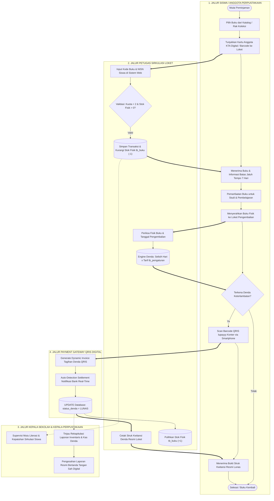
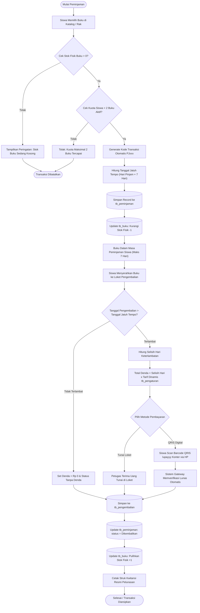
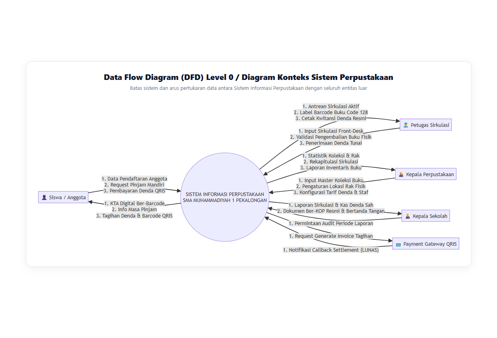
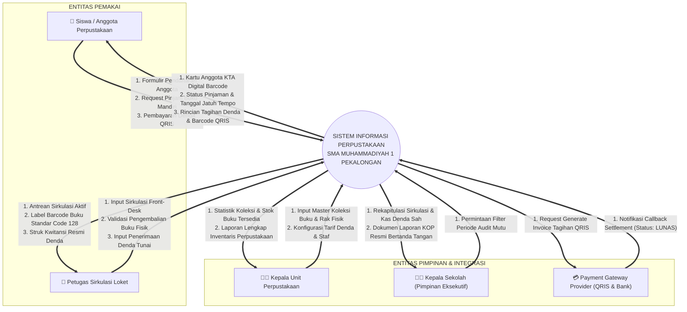
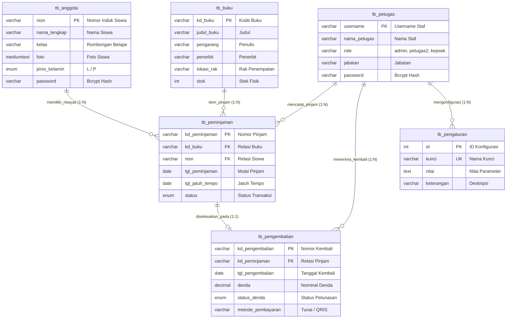
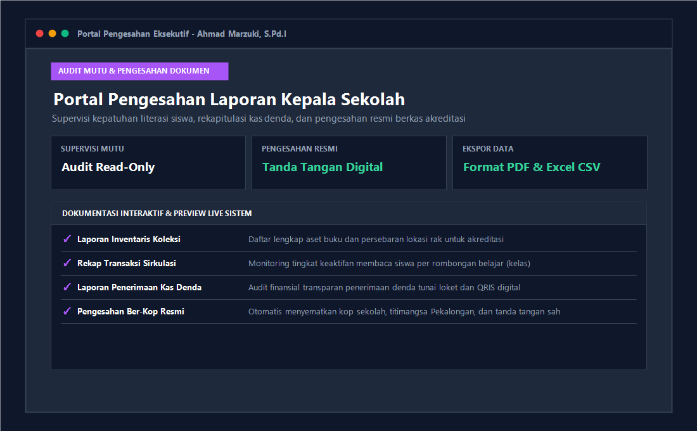

```mermaid
flowchart TD
    subgraph Aktor ["AKTOR PENGGUNA SISTEM"]
        A_Siswa["👤 Siswa / Anggota"]
        A_Petugas["👮 Petugas Sirkulasi"]
        A_Admin["👩‍💼 Kepala Perpustakaan"]
        A_Kepsek["👨‍💼 Kepala Sekolah"]
        A_PG["💳 Payment Gateway Provider"]
    end

    subgraph Modul_Auth ["1. MODUL AUTENTIKASI & REGISTRASI"]
        UC1(["UC01: Login Multi-Role & Registrasi Siswa"])
        UC2(["UC02: Pencarian & Katalog Rak Koleksi Buku"])
    end

    subgraph Modul_Sirkulasi ["2. MODUL LAYANAN SIRKULASI"]
        UC3(["UC03: Peminjaman Buku Mandiri (Maksimal 2 Buku)"])
        UC4(["UC04: Cetak Kartu Anggota KTA Digital Barcode NISN"])
        UC6(["UC06: Pelayanan Front-Desk Peminjaman Loket"])
        UC7(["UC07: Pengembalian Buku & Pemeriksaan Fisik"])
    end

    subgraph Modul_Finansial ["3. MODUL FINANSIAL & DENDA"]
        UC8(["UC08: Kalkulasi Denda Keterlambatan Otomatis"])
        UC5(["UC05: Pembayaran Digital via QRIS Gateway"])
        UC9(["UC09: Cetak Struk Kwitansi Resmi Pelunasan Denda"])
    end

    subgraph Modul_Manajerial ["4. MODUL MANAJERIAL & PELAPORAN"]
        UC10(["UC10: CRUD Master Data Koleksi Buku"])
        UC11(["UC11: Cetak Label Barcode Rak Buku Code 128"])
        UC12(["UC12: Konfigurasi Tarif Denda Global tb_pengaturan"])
        UC13(["UC13: Manajemen Akun Staf Perpustakaan (RBAC)"])
        UC14(["UC14: Audit Mutu & Pengesahan Laporan Eksekutif"])
    end

    A_Siswa --> UC1
    A_Siswa --> UC2
    A_Siswa --> UC3
    A_Siswa --> UC4
    A_Siswa --> UC5

    A_Petugas --> UC1
    A_Petugas --> UC2
    A_Petugas --> UC6
    A_Petugas --> UC7
    A_Petugas --> UC8
    A_Petugas --> UC9
    A_Petugas --> UC11

    A_Admin --> UC1
    A_Admin --> UC2
    A_Admin --> UC10
    A_Admin --> UC11
    A_Admin --> UC12
    A_Admin --> UC13
    A_Admin --> UC14

    A_Kepsek --> UC1
    A_Kepsek --> UC14

    UC7 -.->|"[include]"| UC8
    UC8 -.->|"[extend]"| UC5
    UC8 -.->|"[extend]"| UC9
    A_PG --> UC5
```

# 📚 Sistem Informasi Manajemen Perpustakaan SMA Muhammadiyah 1 Pekalongan Berbasis Web

[](https://react.dev)
[](https://vitejs.dev)
[](https://www.php.net)
[](https://www.mysql.com)
[](https://tailwindcss.com)
[](https://qris.id)
[](#)

> **Tugas Akhir / Skripsi & Basis Data Lanjut**  
> **Universitas Muhammadiyah Metro**  
> **Program Studi:** S1 Ilmu Komputer / Sistem Informasi  
> **Instansi Mitra:** SMA Muhammadiyah 1 Pekalongan, Kabupaten Lampung Timur  

---

## 📑 Daftar Isi
1. [Ringkasan Proyek](#-ringkasan-proyek)
2. [Fitur Utama Sistem](#-fitur-utama-sistem)
3. [Perancangan Sistem & Diagram](#-perancangan-sistem--diagram)
   - [1. Flowchart Aliran Sistem Informasi (ASI) Swimlane](#1-flowchart-aliran-sistem-informasi-asi-swimlane-4-jalur-wewenang)
   - [2. Activity Flowchart Siklus Peminjaman & Pengembalian](#2-activity-flowchart-siklus-peminjaman--pengembalian-end-to-end)
   - [3. Data Flow Diagram (DFD) Level 0 / Konteks](#3-data-flow-diagram-dfd-level-0--diagram-konteks)
   - [4. Use Case Diagram UML](#4-use-case-diagram-uml-14-use-case)
   - [5. Entity Relationship Diagram (ERD) Normalisasi 3NF](#5-entity-relationship-diagram-erd-normalisasi-3nf)
4. [Tangkapan Layar Antarmuka Aplikasi (Screenshots)](#-tangkapan-layar-antarmuka-aplikasi-screenshots)
   - [1. Halaman Login Multi-Role](#1-halaman-login-multi-role)
   - [2. Panel Admin IT / Kepala Perpustakaan](#2-panel-admin-it--kepala-perpustakaan-kelola-buku--staf)
   - [3. Loket Sirkulasi Petugas](#3-loket-sirkulasi-petugas-pelayanan-pinjam-kembali--denda)
   - [4. Dashboard Eksekutif Kepala Sekolah](#4-dashboard-eksekutif-kepala-sekolah-pengesahan-laporan-resmi)
   - [5. Portal Mandiri Siswa](#5-portal-mandiri-siswa-katalog--kta-digital-barcode)
   - [6. Payment Gateway QRIS Otomatis](#6-payment-gateway-qris-otomatis-anti-kecurangan)
5. [Matriks Hak Akses Pengguna & Entitas (RBAC Matrix)](#-matriks-hak-akses-pengguna--entitas-rbac-matrix)
6. [Struktur Basis Data Normalisasi 3NF & Data Dummy (20+ Record)](#-struktur-basis-data-normalisasi-3nf--data-dummy-20-record)
7. [Panduan Instalasi & Menjalankan Proyek](#-panduan-instalasi--menjalankan-proyek)
8. [Akun Pengujian Demo (Credentials)](#-akun-pengujian-demo-credentials)
9. [Pengujian Black Box Testing](#-pengujian-black-box-testing)
10. [Dokumen Laporan & Bukti Unggah GitHub](#-dokumen-laporan--bukti-unggah-github)
11. [Profil Penyusun](#-profil-penyusun)

---

## 📌 Ringkasan Proyek

Sistem Informasi Manajemen Perpustakaan SMA Muhammadiyah 1 Pekalongan merupakan aplikasi berbasis web modern dengan model arsitektur **Modern Decoupled Client-Server (3-Tier)**. Sistem ini dibangun untuk mentransformasikan pengelolaan perpustakaan sekolah konvensional (pencatatan buku besar fisik & sistem legacy) menjadi ekosistem digital yang terintegrasi, transparan, dan terotomatisasi secara komprehensif.

Keunggulan utama sistem ini meliputi:
1. **Model Relasional 3NF & Integritas Transaksi ACID**: Skema basis data normalisasi bentuk ketiga (3NF) dengan foreign key strict di InnoDB MySQL yang mencegah anomali data, memastikan kuota peminjaman maksimal 2 buku per siswa, dan mengelola stok buku fisik secara real-time.
2. **Kalkulasi Denda Dinamis & Konfigurasi Global**: Perhitungan denda keterlambatan berjalan otomatis berdasarkan selisih hari dikalikan tarif denda yang tersimpan pada tabel master `tb_pengaturan`.
3. **Integrasi Digital Payment Gateway QRIS**: Penyelesaian denda keterlambatan dan biaya administrasi perpanjangan pinjaman melalui scan barcode QRIS Nasional (mendukung BCA Mobile, Livin Mandiri, BRImo, BNI, DANA, GoPay, OVO, ShopeePay) dengan verifikasi otomatis dan proteksi anti-kecurangan manual.
4. **Portal Siswa Mandiri & KTA Digital Ber-Barcode**: Siswa dapat mencari katalog buku beserta lokasi rak fisiknya, meminjam buku secara mandiri, dan mengunduh Kartu Tanda Anggota (KTA) digital resmi berstandar nasional lengkap dengan barcode NISN.
5. **Pengesahan Dokumen Laporan Digital Bertanda Tangan**: Eksekutif Kepala Sekolah dapat memantau indikator literasi dan mengesahkan dokumen laporan resmi ber-KOP Majelis Dikdasmen Muhammadiyah lengkap dengan tanda tangan digital dan opsi ekspor ke Microsoft Excel (.CSV).

---

## ⭐ Fitur Utama Sistem

| Modul Fungsional | Deskripsi Kemampuan Sistem | Aktor Pengguna |
| :--- | :--- | :--- |
| **Autentikasi Multi-Role (RBAC)** | Sistem Single-Sign-On tunggal berbasis username atau NISN dengan enkripsi Bcrypt. Dilengkapi pergantian foto profil dan update kredensial. | Admin, Petugas, Kepsek, Siswa |
| **Katalog Master Koleksi Buku** | Pengelolaan data koleksi buku (judul, pengarang, penerbit, tahun terbit, stok fisik), dan lokasi penempatan rak fisik (MIPA, Agama, Bahasa, Sosial). | Kepala Perpustakaan |
| **Generator Barcode Label Rak** | Pembuatan dan pencetakan label barcode standar Code 128 untuk ditempel pada punggung buku fisik perpustakaan. | Petugas & Kepala Perpus |
| **Sirkulasi Peminjaman Cepat** | Validasi kuota maksimal 2 buku aktif, pencegahan peminjaman buku stok 0, auto-generate kode PJxxx, dan pemotongan stok instan. | Petugas & Siswa Mandiri |
| **Pengembalian & Denda Otomatis** | Perhitungan selisih hari keterlambatan x tarif denda harian `tb_pengaturan`, pemulihan stok buku (+1), dan cetak kwitansi resmi loket. | Petugas Sirkulasi |
| **Payment Gateway QRIS Digital** | Pembayaran denda via barcode QRIS tajam (400x400 px), deteksi otomatis status pelunasan Lunas (Settled), dan pencatatan ID transaksi gateway. | Siswa & Petugas |
| **Perpanjangan Durasi (+7 Hari)** | Fasilitas perpanjangan pinjaman buku +7 hari dengan batas frekuensi maksimal 1 kali dan pencatatan biaya administrasi. | Petugas & Siswa |
| **Pengingat WhatsApp Gateway** | Tombol satu klik *Ingatkan WA* untuk mengirimkan pesan WhatsApp penagihan sopan berformat resmi ke nomor HP siswa yang terlambat. | Petugas Sirkulasi |
| **Portal Mandiri Siswa & KTA** | Akses katalog buku, pencarian rak fisik, riwayat transaksi pinjam, dan cetak Kartu Anggota (KTA) digital ber-barcode. | Siswa / Anggota |
| **Audit Mutu & Pengesahan Laporan** | Cetak laporan sirkulasi dan kas denda ber-KOP resmi dengan tanda tangan digital Kepala Sekolah, serta ekspor file spreadsheet (.CSV / Excel). | Kepala Sekolah & Admin |

---

## 📊 Perancangan Sistem & Diagram

Semua diagram dirancang dengan standar akademis teknik informatika, beresolusi ultra-tinggi (*Ultra-HD 300 DPI*), bebas tumpang tindih (*zero overflow*), dan didukung diagram vektor interaktif native Mermaid (*clean rendering*). File grafis original beresolusi tinggi tersedia pada folder `diagram_images`.

### 1. Flowchart Aliran Sistem Informasi (ASI) Swimlane 4 Jalur Wewenang
Diagram ini memetakan pemisahan wewenang (*Separation of Duties*) antara **Siswa/Anggota**, **Petugas Sirkulasi Loket**, **Kepala Sekolah / Kepala Perpus**, dan **Payment Gateway QRIS**.

<p align="center">
  <a href="diagram_images/flowchart_asi_swimlane.png" target="_blank">
    
  </a>
</p>
<p align="center"><em>Gambar 1: Aliran Sistem Informasi (ASI) Swimlane 4 Jalur Wewenang (🔍 Klik gambar untuk resolusi penuh)</em></p>

<details>
<summary><b>🔍 Tampilkan Diagram Vektor Interaktif (Mermaid Code)</b></summary>



</details>

---

### 2. Activity Flowchart Siklus Peminjaman & Pengembalian End-to-End
Diagram alur aktivitas logika sistem mulai dari seleksi buku di rak, verifikasi kuota maksimal 2 buku, pemotongan stok otomatis, pemantauan tanggal tempo, kalkulasi denda keterlambatan, pelunasan QRIS, hingga penerbitan bukti kwitansi.

<p align="center">
  <a href="diagram_images/activity_flowchart_sirkulasi.png" target="_blank">
    
  </a>
</p>
<p align="center"><em>Gambar 2: Activity Flowchart Logika Sirkulasi Perpustakaan End-to-End (🔍 Klik gambar untuk resolusi penuh)</em></p>

<details>
<summary><b>🔍 Tampilkan Diagram Vektor Interaktif (Mermaid Code)</b></summary>



</details>

---

### 3. Data Flow Diagram (DFD) Level 0 / Diagram Konteks
Memodelkan batas sistem (*system boundary*) serta arus pertukaran data antara Sistem Informasi Perpustakaan SMA Muhammadiyah 1 Pekalongan dengan 4 entitas eksternal (*Siswa*, *Petugas Sirkulasi*, *Kepala Perpustakaan*, *Kepala Sekolah*, serta *Payment Gateway QRIS Provider*).

<p align="center">
  <a href="diagram_images/dfd_level_0_konteks.png" target="_blank">
    
  </a>
</p>
<p align="center"><em>Gambar 3: Data Flow Diagram (DFD) Level 0 / Diagram Konteks (🔍 Klik gambar untuk resolusi penuh)</em></p>

<details>
<summary><b>🔍 Tampilkan Diagram Vektor Interaktif (Mermaid Code)</b></summary>



</details>

---

### 4. Use Case Diagram UML (14 Use Case)
Memetakan 14 fungsionalitas utama sistem ke dalam 4 modul utama (Autentikasi, Layanan Sirkulasi, Finansial Denda QRIS, dan Manajerial Pelaporan Eksekutif).

<p align="center">
  <a href="diagram_images/usecase_diagram_perpustakaan.png" target="_blank">
    
  </a>
</p>
<p align="center"><em>Gambar 4: Use Case Diagram UML Sistem Perpustakaan SMA Muhammadiyah 1 Pekalongan (🔍 Klik gambar untuk resolusi penuh)</em></p>

<details>
<summary><b>🔍 Tampilkan Diagram Vektor Interaktif (Mermaid Code)</b></summary>



</details>

---

### 5. Entity Relationship Diagram (ERD) Normalisasi 3NF
Rancangan basis data relasional 3NF yang menghubungkan 6 tabel utama tanpa anomali data (*insertion*, *update*, atau *deletion anomaly*) dengan integritas Foreign Key aktif di engine InnoDB MySQL.

<p align="center">
  <a href="diagram_images/erd_basis_data_3nf.png" target="_blank">
    
  </a>
</p>
<p align="center"><em>Gambar 5: Entity Relationship Diagram (ERD) Normalisasi 3NF Terelasi (🔍 Klik gambar untuk resolusi penuh)</em></p>

<details>
<summary><b>🔍 Tampilkan Diagram Vektor Interaktif (Mermaid Code)</b></summary>



</details>

---

## 🖥️ Tangkapan Layar Antarmuka Aplikasi (Screenshots)

Berikut adalah dokumentasi antarmuka aplikasi yang telah berjalan secara langsung (*live system*). Gambar tersimpan di folder `SS`.

### 1. Halaman Login Multi-Role
Halaman autentikasi gerbang tunggal dengan validasi username/NISN dan password terenkripsi, dilengkapi tombol pintas demo role untuk mempermudah evaluasi pengujian.

<p align="center">
  
</p>
<p align="center"><em>Gambar 6: Tampilan Halaman Login Multi-Role Aplikasi</em></p>

---

### 2. Panel Admin IT / Kepala Perpustakaan (Kelola Buku & Staf)
Dashboard khusus Kepala Unit Perpustakaan untuk manajemen data master koleksi buku, penataan rak fisik, pengaturan tarif denda dinamis, generator barcode rak, dan manajemen akun staf.

<p align="center">
  
</p>
<p align="center"><em>Gambar 7: Tampilan Dashboard & Manajemen Koleksi oleh Kepala Unit Perpustakaan</em></p>

---

### 3. Loket Sirkulasi Petugas (Pelayanan Pinjam, Kembali & Denda)
Panel Petugas Sirkulasi untuk pencatatan pinjaman buku front-desk, validasi pengembalian fisik buku, perhitungan denda otomatis, tombol perpanjang +7 hari, kirim pengingat WhatsApp, dan cetak kwitansi loket.

<p align="center">
  
</p>
<p align="center"><em>Gambar 8: Tampilan Pengolahan Data Transaksi Sirkulasi oleh Petugas Loket</em></p>

---

### 4. Dashboard Eksekutif Kepala Sekolah (Pengesahan Laporan Resmi)
Dashboard Pimpinan Sekolah untuk mengaudit keaktifan membaca siswa per kelas, meninjau rekonsiliasi kas denda, dan mengesahkan dokumen laporan resmi ber-KOP sekolah dengan tanda tangan digital sah.

<p align="center">
  
</p>
<p align="center"><em>Gambar 9: Tampilan Dashboard Supervisi dan Pengesahan Laporan oleh Kepala Sekolah</em></p>

---

### 5. Portal Mandiri Siswa (Katalog & KTA Digital Barcode)
Portal khusus siswa untuk menelusuri katalog buku dan lokasi rak secara mandiri, mengajukan peminjaman buku (kuota maks 2), memantau riwayat pinjam, serta mengunduh Kartu Tanda Anggota (KTA) digital resmi ber-barcode NISN.

<p align="center">
  
</p>
<p align="center"><em>Gambar 10: Tampilan Portal Mandiri Siswa & Kartu Digital KTA</em></p>

---

### 6. Payment Gateway QRIS Otomatis (Anti-Kecurangan)
Gerbang pembayaran digital QRIS resolusi tinggi (400x400 px) yang langsung dapat di-scan dari seluruh aplikasi mobile banking dan e-wallet nasional dengan verifikasi status otomatis.

<p align="center">
  
</p>
<p align="center"><em>Gambar 11: Tampilan Modal Payment Gateway QRIS Real-Time</em></p>

---

## 🔐 Matriks Hak Akses Pengguna & Entitas (RBAC Matrix)

Sistem Informasi Manajemen Perpustakaan SMA Muhammadiyah 1 Pekalongan mengimplementasikan kendali otorisasi ketat berbasis peran (*Role-Based Access Control / RBAC*) yang memisahkan wewenang antara 4 entitas pengguna terhadap 6 entitas tabel basis data:

> 📘 **Dokumentasi Lengkap:** Spesifikasi komprehensif, diagram otorisasi, dan 20 wewenang operasional tersedia di [MATRIKS_HAK_AKSES_DAN_ENTITAS.md](MATRIKS_HAK_AKSES_DAN_ENTITAS.md).

### Ringkasan Matriks CRUD (Create, Read, Update, Delete)

| Entitas Basis Data / Modul | Kepala Perpustakaan (`admin`) | Petugas Sirkulasi (`petugas2`) | Kepala Sekolah (`kepsek`) | Siswa / Anggota (`siswa`) |
| :--- | :---: | :---: | :---: | :---: |
| **`tb_buku` (Master Koleksi Buku)** | **C, R, U, D** | **R** | **R** | **R** |
| **`tb_anggota` (Data Siswa/Anggota)** | **C, R, U, D** | **R, U** | **R** | **C, R, U\*** |
| **`tb_petugas` (Akun Staf & RBAC)** | **C, R, U, D** | **R, U\*** | **R** | **-** |
| **`tb_peminjaman` (Transaksi Pinjam)** | **C, R, U, D** | **C, R, U** | **R** | **C\*, R\*** |
| **`tb_pengembalian` (Pengembalian)** | **C, R, U, D** | **C, R, U** | **R** | **R\*** |
| **`tb_pengaturan` (Konfigurasi SOP)** | **C, R, U, D** | **R, U** | **R** | **R** |
| **Modul Denda & Kwitansi** | **C, R, U, D** | **C, R, U** | **R** | **R\*, Pay** |
| **Laporan & Dokumen Resmi** | **R, Export, Print** | **R, Export, Print** | **R, Export, Sign** | **R\*** |

*\*Catatan:* Hak akses siswa dan petugas dibatasi sesuai prinsip *least privilege*: Siswa hanya dapat mengelola data profil miliknya sendiri serta melihat riwayat peminjaman dan denda pribadinya.

---

## 🗄️ Struktur Basis Data Normalisasi 3NF & Data Dummy (20+ Record)

Basis data dirancang dengan mematuhi kaidah **Bentuk Normal Ketiga (3NF)**:
1. **1NF**: Setiap atribut bersifat atomik dan tidak terdapat grup data berulang (*repeating groups*).
2. **2NF**: Seluruh atribut non-kunci bergantung penuh pada Primary Key (*no partial functional dependency*).
3. **3NF**: Tidak ada ketergantungan transitif antar atribut non-kunci (*no transitive dependency*).

```
tb_petugas (username, nama_petugas, role, jabatan, foto, password, remember_token)
    └── 1:N ──> tb_peminjaman (kd_peminjaman, kd_buku, nisn, nama_anggota, tgl_peminjaman, tgl_jatuh_tempo, status, petugas_pinjam, perpanjangan_count, biaya_perpanjangan, metode_bayar_perpanjang, id_transaksi_perpanjang)
                    ├── N:1 ──> tb_buku (kd_buku, judul_buku, pengarang, penerbit, lokasi_rak, tahun_terbit, stok)
                    ├── N:1 ──> tb_anggota (nisn, nama_lengkap, kelas, foto, jenis_kelamin, password)
                    └── 1:1 ──> tb_pengembalian (kd_pengembalian, kd_peminjaman, tgl_pengembalian, keterangan, denda, status_denda, metode_pembayaran, id_transaksi_gateway, waktu_bayar, petugas_kembali)

tb_pengaturan (id, kunci, nilai, keterangan, diubah_oleh, updated_at)
```

### Volume Data Dummy Pengujian (Dual-Layer Sync)
Sistem telah dilengkapi dengan dataset dummy realistis yang tersinkronisasi ganda pada **MySQL Server** (`backend/database/skripsi_perpus.sql`) dan **Mock Store Frontend** (`frontend/src/api/axios.js`):
- **25 Master Koleksi Buku (`tb_buku`)**: Koleksi buku fiksi, non-fiksi, MIPA, Agama, Bahasa, Sosial, dan Teknologi (`BK001` - `BK025`).
- **25 Master Anggota Siswa (`tb_anggota`)**: Siswa aktif kelas X, XI, dan XII lengkap dengan NISN, No HP, dan Alamat (`2024001` - `2024025`).
- **25 Transaksi Peminjaman (`tb_peminjaman`)**: Transaksi riwayat dan transaksi aktif berstatus `dipinjam` dan `kembali` (`PJ001` - `PJ025`).
- **20 Transaksi Pengembalian & Denda (`tb_pengembalian`)**: Transaksi pengembalian dengan kalkulasi denda, status pembayaran via QRIS dan Tunai Loket (`KB001` - `KB020`).
- **3 Akun Petugas & Supervisor (`tb_petugas`)**: Kepala Perpus (`admin`), Petugas Sirkulasi (`petugas2`), dan Kepala Sekolah (`kepsek`).
- **1 Pengaturan Kebijakan SOP (`tb_pengaturan`)**: Tarif denda harian (Rp 1.000/hari), durasi standar pinjam (7 hari), dan biaya administrasi perpanjang (Rp 0).

---

## 🚀 Panduan Instalasi & Menjalankan Proyek

### Prasyarat Perangkat Lunak
- **Web Server & Database**: XAMPP v3.3+ (Apache & MySQL / MariaDB)
- **Runtime Environment**: Node.js v18+ dan NPM v9+
- **PHP**: Versi `8.2` atau lebih baru
- **Web Browser**: Google Chrome / Microsoft Edge / Mozilla Firefox

---

### Langkah-Langkah Menjalankan Aplikasi

#### Cara 1: Sekali Klik (Rekomendasi Windows)
Cukup klik dua kali file pintasan berikut pada direktori utama proyek:
```
JALANKAN_PERPUSTAKAAN.bat
```
*Skrip ini akan secara otomatis menyalakan Backend PHP, Frontend React, dan membuka browser secara langsung.*

---

#### Cara 2: Menjalankan Secara Manual via Terminal

1. **Clone Repositori**:
   ```bash
   git clone https://github.com/fanydarat757-hash/antigrafitytest.git
   cd antigrafitytest
   ```

2. **Persiapan Basis Data (MySQL / phpMyAdmin)**:
   - Pastikan modul **MySQL** pada XAMPP Control Panel dalam status `Running`.
   - Buka terminal PowerShell lalu impor skema database lengkap:
     ```powershell
     & "C:\xampp\mysql\bin\mysql.exe" -u root < "backend\database\skripsi_perpus.sql"
     ```

3. **Jalankan Backend RESTful API**:
   ```powershell
   cd backend
   C:\xampp\php\php.exe -S 127.0.0.1:8000 -t public
   ```
   *Backend API aktif di:* `http://127.0.0.1:8000`

4. **Jalankan Frontend React (Vite SPA)**:
   Buka jendela terminal baru:
   ```powershell
   cd frontend
   npm install
   npm run dev
   ```
   *Aplikasi web siap diakses di:* [http://localhost:3000](http://localhost:3000)

---

## 🔑 Akun Pengujian Demo (Credentials)

Untuk mempermudah evaluasi pengujian fitur berdasarkan kontrol akses berbasis peran (*Role-Based Access Control*), gunakan akun demo berikut:

| Peran (Role) | Username / NISN | Password | Deskripsi Wewenang Akun |
| :--- | :--- | :--- | :--- |
| **Kepala Unit Perpustakaan** | `admin` | `admin123` | Akses penuh: Master buku, penataan rak, tarif denda, staf & laporan |
| **Petugas Sirkulasi Loket** | `petugas2` | `petugas123` | Pelayanan loket: Pinjam, kembali, denda tunai, barcode, dan notifikasi WA |
| **Kepala Sekolah** | `kepsek` | `kepsek123` | Pengawasan mutu: Audit sirkulasi, kas denda, dan pengesahan laporan resmi |
| **Siswa / Anggota** | `2024001` | `siswa123` | Portal mandiri: Katalog buku, pinjam mandiri, QRIS denda, cetak KTA |

---

## 🧪 Pengujian Black Box Testing

Pengujian fungsionalitas sistem dilakukan menggunakan metode **Black Box Testing** pada 12 skenario pengujian utama:

| No | Skenario Pengujian | Masukan (Input) | Hasil yang Diharapkan | Status |
| :-: | :--- | :--- | :--- | :-: |
| 1 | Autentikasi Login Multi-Role | Input username & password 4 role akun | Berhasil masuk ke dashboard sesuai hak akses masing-masing | **Valid (100%)** |
| 2 | Proteksi Akses & Password | Input password salah atau tidak terdaftar | Sistem menolak akses dan memunculkan toast peringatan error | **Valid (100%)** |
| 3 | Registrasi Anggota Siswa Baru | Input NISN, Nama, dan Kelas siswa baru | Data tersimpan di `tb_anggota` dan KTA digital aktif instan | **Valid (100%)** |
| 4 | Validasi Kuota Maksimal Pinjam | Siswa meminjam buku ke-3 saat 2 buku aktif | Sistem menolak pinjaman ke-3 sesuai SOP kuota perpustakaan | **Valid (100%)** |
| 5 | Validasi Stok Buku Habis | Meminjam buku fisik dengan stok = 0 | Peminjaman ditolak dan form menampilkan peringatan stok habis | **Valid (100%)** |
| 6 | Perpanjangan Pinjaman (+7 Hari) | Klik perpanjang pada transaksi `count = 0` | Tanggal tempo bertambah +7 hari dan tombol terkunci (maks 1x) | **Valid (100%)** |
| 7 | Kalkulasi Denda Keterlambatan | Buku terlambat 3 hari (Tarif Rp 1.000/hari) | Denda terhitung otomatis tepat $3 \times \text{Rp } 1.000 = \text{Rp } 3.000$ | **Valid (100%)** |
| 8 | Pembayaran Denda QRIS Gateway | Scan barcode QRIS dan verifikasi | Status denda berubah menjadi *Lunas* dan ID gateway tersimpan | **Valid (100%)** |
| 9 | Notifikasi WhatsApp Gateway | Klik tombol *Ingatkan WA* pada pinjaman jatuh tempo | Membuka API WhatsApp dengan template draf penagihan resmi | **Valid (100%)** |
| 10 | Cetak Kartu Anggota (KTA) Digital | Klik cetak KTA pada portal siswa | Tampil kartu anggota standar nasional lengkap barcode NISN & foto | **Valid (100%)** |
| 11 | Pengesahan Laporan Kepala Sekolah | Cetak laporan pada akun Kepala Sekolah | Lembar laporan memuat kop resmi dan tanda tangan digital sah | **Valid (100%)** |
| 12 | Ekspor Rekapitulasi Excel CSV | Klik tombol *Export ke Excel/CSV* | File `.csv` terunduh sempurna dan dapat dibuka rapi di Excel | **Valid (100%)** |

---

## 📑 Dokumen Laporan & Bukti Unggah GitHub

Untuk keperluan peninjauan akademis, sidang tugas akhir / skripsi, dan evaluasi mata kuliah Basis Data Lanjut, seluruh dokumen spesifikasi teknis dan laporan kemajuan proyek telah disediakan secara komprehensif:

| Dokumen Rujukan | Deskripsi Dokumen | Tautan Berkas |
| :--- | :--- | :--- |
| **Matriks Hak Akses & Entitas** | Spesifikasi RBAC 4 Aktor x 6 Entitas, matriks CRUD, dan 20 izin operasional | [MATRIKS_HAK_AKSES_DAN_ENTITAS.md](MATRIKS_HAK_AKSES_DAN_ENTITAS.md) |
| **Laporan Pengembangan & Progres** | Laporan detail implementasi sistem, pengujian 20+ dataset dummy, dan bukti unggah | [LAPORAN_PROGRESS_DAN_MATRIKS_SISTEM.md](LAPORAN_PROGRESS_DAN_MATRIKS_SISTEM.md) |
| **Panduan Teknis & Arsitektur** | Blueprint arsitektur 3-tier, relasi 3NF, DFD konteks, dan flowchart sistem | [PANDUAN_TEKNIS_DAN_ARSITEKTUR_SKRIPSI.md](PANDUAN_TEKNIS_DAN_ARSITEKTUR_SKRIPSI.md) |
| **Skema Basis Data SQL (3NF)** | Skrip DDL & DML MySQL dengan 25 buku, 25 anggota, 25 pinjam, 20 kembali | [skripsi_perpus.sql](backend/database/skripsi_perpus.sql) |

---

## 👨‍🎓 Profil Penyusun

- **Perguruan Tinggi:** Universitas Muhammadiyah Metro  
- **Fakultas / Program Studi:** S1 Ilmu Komputer / Sistem Informasi  
- **Mata Kuliah / Tugas:** Basis Data Lanjut (Semester 5) / Tugas Akhir Skripsi  
- **Tahun Akademik:** 2026 / 2027  
- **Instansi Penelitian:** SMA Muhammadiyah 1 Pekalongan, Kab. Lampung Timur  
- **Repositori GitHub:** [https://github.com/fanydarat757-hash/antigrafitytest](https://github.com/fanydarat757-hash/antigrafitytest)  

---
